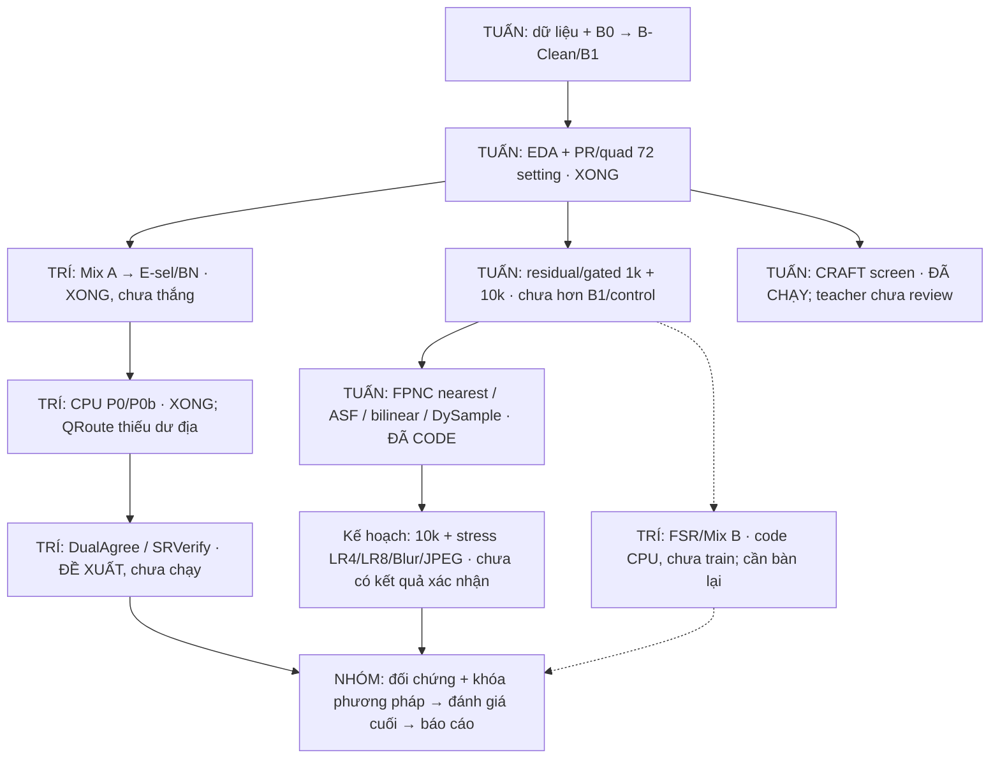
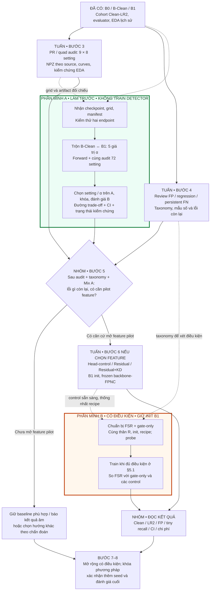
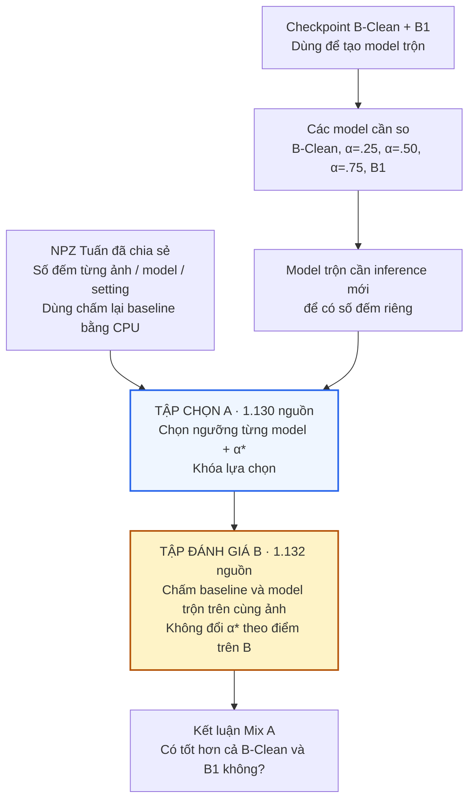

# Kế hoạch phối hợp với Tuấn: pipeline chung và phần mình phụ trách

> Cập nhật 24/11 Codex: hướng mới DỰ KIẾN ở `docs/KE_HOACH_BOX_QUALITY_20261124.md` (với file trong docs, xem cùng thư mục). Chỉ audit và chuẩn bị membership TRAIN; chưa implementation/GPU/kết quả. Không đổi protocol hoặc kết quả cũ. Đọc trạng thái mới nhất trong HANDOFF.

> **CẬP NHẬT PIPELINE 22/11 — ưu tiên hơn các đoạn trạng thái lịch sử 19/11 bên dưới.** Repo Tuấn đã đồng bộ `96612b4`. Mix A của Trí đã chạy xong và chưa thắng; báo cáo ở `docs/report_mix_a_v1.md`. Latent adapter của Tuấn cả 1k/10k chưa hơn B1/control theo tài liệu repo mới. Hướng Tuấn hiện tại là fusion/upsampling trong FPNC: nearest, ASF, bilinear, DySample; mọi arm train FPNC+DBHead, freeze backbone. Code đã commit, chưa xác nhận kết quả job fusion. CRAFT đã screen độc lập (LR2 47,00%; 0 TP bin <4 px), chưa tạo cải tiến Monkey. Trí đang chẩn đoán v2, hướng DualAgree chưa chạy; FSR/Mix B vẫn có điều kiện. Không diễn giải các đoạn “chưa code/chưa chạy” lịch sử phía dưới thành trạng thái hiện tại.



Nguồn mới: `../../MONKEY_V2/docs/fusion_research_and_generalization.md`; số 10k/CRAFT là kết luận công bố trong repo, chưa được tính lại từ raw artifact local. Review tay vẫn pending. Không đổi protocol hoặc kết quả thí nghiệm cũ.

> **TÀI LIỆU CHÍNH VỀ WORKFLOW:** cập nhật phạm vi, phương pháp và quyết định phối hợp tại file này. Các bản kế hoạch cá nhân/khảo sát cũ đã chuyển vào `_archive/`; dashboard chỉ theo dõi tiến độ. [Danh mục tài liệu](README.md).

**Ngày:** 19/11/2026 · **Phạm vi:** MonkeyOCRv2-based Text Detection, Clean/native LR2.  
**Mục đích:** một bản duy nhất để thống nhất công việc, đầu vào cần chia sẻ và điều kiện chạy.  
**Trạng thái cập nhật 19/11/2026:** đã đồng bộ repo Tuấn tới `dc19b85` và kiểm tra gói PR/quad cùng checkpoint tải về. Phần mình đã có `mixab/weight_merge.py`, `reselect_split.py`, `fsr.py`; 29/29 test local PASS trong lượt kiểm tra này. `merge_audit.py` chưa có; chưa có kết quả inference/train Mix A/B. Tuấn ủng hộ Mix A trước, Mix B có điều kiện theo tin nhắn user chuyển lại; các chi tiết còn treo không tự được coi là đã chốt. Hiện trạng và việc Claude cần làm tiếp nằm trong [HANDOFF.md](HANDOFF.md).

## 0. Tiến độ đã kiểm tra từ repo Tuấn — đọc trước khi triển khai

**Repo:** `main = origin/main = dc19b85` sau fetch và fast-forward từ `37384cf`. Gói tham chiếu nằm tại `MONKEY_V2/docs/handoff/artifacts/pr_quad_audit_v1/`. Đã tải Git LFS cho B-Clean, B1 và ZIP review; chạy `verify_bundle.py --counts --weights` **PASS** (hash, receipt báo cáo, counts/metrics và weights). Đây là kiểm chứng gói baseline, **không phải** trạng thái VERIFIED của thí nghiệm Mix A chưa chạy.

| Hạng mục | Hiện trạng có bằng chứng | Hệ quả cho phần mình |
|---|---|---|
| Sweep 54308 | Ba sweep xong; job FAILED ở review, elapsed 01:06:37 | Không coi elapsed này là thời gian merge dự đoán chính xác |
| Recovery 63985 | Slurm COMPLETED, exit 0, 00:04:07; có completion receipt | Không cần chờ recovery nữa |
| NPZ + GT/ROI + EDA common counts | Có local, verifier PASS; NPZ `(2262,2,72,5)` | Có thể chọn lại baseline A→B bằng CPU ngay |
| B-Clean/B1 | Plain state_dict Git LFS đã tải, hash PASS | Không cần chờ B-Clean từ HPC; bản xuất dùng `weights_only=True`, không cần `--allow-pickle` |
| Review | 160 thẻ, **0 nhãn tay**; dữ liệu ở common `.30/.40` | Bước 4 chưa hoàn tất; chưa mở train Mix B từ proxy |
| Code của mình | A1/A3/FSR đã có và 29 test PASS; A2 chưa viết | Claude tiếp tục từ NPZ thật và A2, không code lại từ đầu |

**Baseline mở rộng — tính lại từ NPZ trên toàn bộ 2.262 nguồn:**

| Model | Setting tốt nhất toàn cohort | Clean Hmean | LR2 Hmean | LR2 FP | LR2 recall <4 px |
|---|---|---:|---:|---:|---:|
| B0 | mask .30 / score .45 / epsilon .005 | 74,09% | 62,38% | 4.069 | 1,01% |
| B-Clean | mask .40 / score .60 / epsilon .010 | 80,86% | 75,51% | 6.578 | 15,96% |
| B1 | mask .40 / score .60 / epsilon .010 | 79,43% | 76,90% | 11.997 | 45,79% |

Unclip 1.5, min width 5 cho cả ba. Đã tính bằng exact fractions: mỗi model có một nghiệm tối ưu duy nhất, index 44/70/70. Sai mô tả tie-break trong báo cáo cũ không đổi các số này. Đính chính nằm trong README của gói mới; giữ nguyên báo cáo lịch sử để bảo toàn hash.

**Pipeline A/B giữ nguyên; các cập nhật bắt buộc khi thực hiện:**

- Các số mới trên là baseline toàn cohort, không phải điểm baseline trên B. Vẫn chọn lại setting của B-Clean/B1 và từng α trên A, khóa rồi đánh giá B theo R1; không trừ điểm merge trên B với điểm baseline toàn cohort.
- Các bảng `.30/.40` phía dưới là lịch sử để kiểm chứng và giải thích động cơ, không còn đại diện baseline hậu xử lý mạnh nhất.
- Taxonomy/quần thể 9.697/3.667 và 160 thẻ hiện thuộc `.30/.40`. Khi quyết định theo lỗi còn lại ở setting mới, xác định lại quần thể và review phù hợp; đổi mask có thể đổi contour, không chỉ lọc score.
- Mỗi tầng chỉ có một thẻ; trọng số không tự bảo đảm tỷ lệ background chính xác. Nếu sát mốc 40%, cần tăng mẫu ở các tầng liên quan; không xem 160 thẻ tổng là 160 FP của quần thể mục tiêu.
- Model Stock hoãn tới khi Mix A-core có báo cáo. Mix B tiếp tục chuẩn bị có điều kiện, vẫn init B1; thân R/padding/scheduler/tiêu chí còn cần thống nhất.

## 1. Tuấn đọc phần này trước

Mình dự kiến làm **Mix A-core trước**: nội suy trọng số giữa B-Clean và B1, rồi đánh giá bằng đúng lưới quad của Tuấn. Mục tiêu là xem có giữ được recall chữ nhỏ của B1 mà giảm FP và bảo toàn Clean không. Đây là thí nghiệm không train detector; đầu ra chính là đường trade-off theo hệ số trộn, kể cả khi không tìm được model tốt hơn.

**Mix B là phần có điều kiện:** thêm FSR và gate-only vào pilot residual sau FPNC. Mình có thể chuẩn bị code/probe trong lúc chờ Mix A, nhưng quyết định train đầy đủ dựa trên taxonomy, lỗi còn lại sau hậu xử lý/Mix A và việc residual control đã sẵn sàng. Mix B vẫn khởi tạo từ **B1**, không tự đổi sang checkpoint merge của Mix A.

| Nội dung | Phần mình dự kiến làm | Phần cần phối hợp với Tuấn |
|---|---|---|
| PR/quad audit – Bước 3 | Dùng lại grid, matcher và quy tắc chọn; đối chiếu endpoint | Xác nhận trạng thái job, chia sẻ artifact và cấu hình/hash |
| FP taxonomy – Bước 4 | Đọc kết quả để quyết định có mở Mix B | Chia sẻ review có mẫu số, cách lấy mẫu/trọng số và kết luận còn bất định |
| Mix A-core | `weight_merge.py`, `reselect_split.py`, `merge_audit.py`; kiểm thử, đường cong α và báo cáo | Thống nhất R1, output version, ngưỡng đi tiếp và đường dẫn đầu vào |
| Pilot latent – Bước 6 | Khi đủ điều kiện: FSR + gate-only, kiểm thử và báo cáo đối chứng | Thống nhất thân residual, init chung, recipe, lịch chạy các control |
| HPC và bàn giao | Chuẩn bị lệnh/config; mình thao tác submit trên HPC khi có quyền truy cập | Phối hợp queue/tài nguyên, tránh chạy trùng; không mặc định giao Tuấn chạy hộ |

**Cần thống nhất ngay:**

1. Output mới `.runtime/rev4_merge_audit/v1/`. Code của mình **không** đặt vào repo MONKEY_V2, mà nằm ở repo riêng của mình (package `mixab/`, quyết định ngày 19/11). MONKEY_V2 chỉ được dùng làm tham chiếu pipeline, đọc theo commit được ghi lại.
2. Dùng R1 ở §4 cho mọi model. Code đang ưu tiên tie-break native `.30/.30`; câu ưu tiên `.30/.40` trong `pr-quad-audit-v1.md` cần đồng bộ với quyết định chung.
3. +0,5 pp mean Hmean và recall LR2 <4 px ≥42% là ngưỡng thực dụng cho pilot, chưa phải tiêu chuẩn chứng minh cải tiến.
4. Nếu mở Mix B, thêm **hai nhánh FSR và gate-only**. Nếu giữ đủ Head-control/Residual/Residual+KD của Tuấn thì tổng cộng **năm nhánh**, không phải bốn. Phân công và budget từng nhánh cần thống nhất.

## 2. Pipeline chung — khoanh vùng phần mình phụ trách

**Cách đọc:** **[TUẤN]** là phần theo workflow hiện có; **[MÌNH — A/B]** là phần mình đề xuất nhận; **[NHÓM]** là điểm cùng quyết định. Phân công là đề xuất chờ thống nhất. Giữ số bước 3–8 của tài liệu Tuấn để dễ đối chiếu; các khối A/B được chèn vào, không đánh số lại pipeline.

### 2.1. Điểm xuất phát và sơ đồ tổng thể

Nền tảng đã có là B0, B-Clean, B1 và các báo cáo EDA/pilot trước. Mình sử dụng checkpoint và dữ liệu đã khóa, không bắt đầu bằng train lại các baseline này.

| Kết quả lịch sử | B-Clean | B1 | Vấn đề cần giải quyết |
|---|---:|---:|---|
| Clean Hmean | 78,79% | 77,55% | B1 giảm chất lượng Clean |
| LR2 Hmean | 74,36% | 75,29% | Tăng tổng thể còn nhỏ; CI chênh lệch đã báo gồm 0 |
| LR2 recall GT <4 px | 19,31% | 45,02% | B1 cứu được nhiều chữ cực nhỏ |
| LR2 FP | 10.457 | 16.487 | Đổi lại là tăng ròng 6.030 FP |

Các số trên được dẫn lại từ workflow của Tuấn, không phải kết quả Mix A/B. Câu hỏi chung là **giữ lợi ích tiny recall, giảm FP và bảo toàn Clean**. Chưa thể suy từ bảng này rằng FP do cao tần hay lỗi nằm ở backbone/FPNC.

Trong sơ đồ, **khung xanh lá A và khung cam B là phần mình nhận**. Mũi tên liền chỉ luồng kết quả/quyết định; mũi tên đứt chỉ việc chuyển giao đầu vào hoặc chuẩn bị, không mặc định phải đợi xong toàn bộ bước trước.



Nếu trình đọc không hiển thị Mermaid, các khối **PHẦN MÌNH A/B** bên dưới trình bày cùng luồng bằng chữ, có đường phân cách riêng.

### Đọc sơ đồ cho dễ: baseline, B1 và split B là gì?

**Baseline là model đối chứng:** dùng nó làm mốc để biết phương pháp của mình có tốt hơn không. Trong Mix A, hai baseline chính là **B-Clean** (fine-tune bằng Clean) và **B1** (fine-tune bằng Clean/LR2). B0 là mốc tham khảo trước thích nghi dữ liệu. Trộn hai checkpoint tạo ra các model ứng viên; mình phải so chúng với cả hai baseline theo cùng cách chấm.

| Tên | Là gì? | Dùng để làm gì? |
|---|---|---|
| **B1** | Một model đã có trọng số | Baseline và một đầu mút để trộn với B-Clean |
| **Split A — tập chọn cấu hình** | 1.130 nguồn ảnh của cohort development | Chọn ngưỡng cho mỗi model và chọn hệ số trộn α* |
| **Split B — tập đánh giá** | 1.132 nguồn ảnh còn lại | Chấm các lựa chọn đã khóa; xem ứng viên có hơn baseline không |
| **Mix B** | Phương án cải tiến feature bằng FSR/gate-only | Một nhánh nghiên cứu khác, không phải split B |

Số nguồn A/B đã đếm từ ID trong NPZ thật theo quy tắc hash hiện tại. Mỗi nguồn có cả bản Clean và LR2; hai bản luôn đi cùng split. Việc chia này phục vụ **chọn và đánh giá**, không phải chia TRAIN/TEST mới, cũng không train lại B-Clean/B1.



**Vì sao cần tách A/B?** Nếu vừa thử nhiều cấu hình vừa chọn cấu hình đẹp nhất trên cùng tập ảnh, điểm dễ lạc quan. A dành cho lựa chọn, B dành cho kiểm tra lựa chọn đó. Tuy vậy, toàn bộ development đã được dùng ở nghiên cứu trước nên B chưa phải TEST độc lập cuối cùng.

**Vì sao không dùng thẳng bảng baseline mới của Tuấn?** Các điểm 80,86/75,51 của B-Clean và 79,43/76,90 của B1 được chọn/chấm trên toàn bộ 2.262 nguồn. Thí nghiệm Mix A chấm trên 1.132 nguồn của B, nên phải tính lại điểm baseline trên chính B với ngưỡng đã chọn trên A. Không trộn hai phạm vi chấm trong một phép so sánh.

**Không cần chờ B-Clean/NPZ nghĩa là:** hai đầu vào đã tải về và kiểm hash/counts PASS. Checkpoint phục vụ merge; NPZ phục vụ chọn lại baseline và đối chiếu endpoint. Có đầu vào không đồng nghĩa đã có kết quả Mix A — các checkpoint trộn vẫn cần inference mới và kiểm chứng.

### 2.2. [TUẤN] Bước 3 và 4 — tạo baseline hậu xử lý và chẩn đoán

**Bước 3: PR/quad audit — đã có artifact hoàn tất và kiểm chứng local tại `dc19b85` (xem §0).**

- **Nhận:** B0/B-Clean/B1, cùng source Clean/LR2 và evaluator đã khóa.
- **Làm:** kiểm tra tái lập common `.30/.40`; chạy 9 cấu hình geometry/mask × 8 ngưỡng score; đọc PR, FP tại mức recall chung và ảnh hưởng của tạo/lọc quad.
- **Xuất:** số đếm từng source trong `*_source_counts.npz`, curves/frontier, audit bộ lọc, config/hash và thời gian chạy.
- **Chuyển cho mình:** checkpoint/config/manifest + grid/matcher + artifact đối chiếu. Mình dùng lại logic này để mọi model merge được đánh giá theo cùng quy trình.

**Bước 4: taxonomy — có thể làm cùng đợt với Bước 3.**

- **Nhận:** predictions/EDA, paired transitions, các ca FP/FN và ảnh/P-map để review.
- **Làm:** phân biệt background, duplicate, split/merge, lệch hộp, filter và nhãn chưa rõ; xem cả regression, persistent FN và chữ nhỏ đã cứu được. Nhãn heuristic cần được phân biệt với review tay.
- **Xuất:** taxonomy có mẫu số/cách lấy mẫu/trọng số và mô tả lỗi còn lại. Không coi tăng ròng 6.030 FP là một danh sách đã xác định toàn bộ là nền giả.
- **Chuyển cho mình/nhóm:** bằng chứng để quyết định mở Mix B. Mình không tự suy nguyên nhân từ Hmean/FP tổng.

---

> **PHẦN MÌNH A — CHÈN SAU BƯỚC 3, ĐƯA KẾT QUẢ VÀO BƯỚC 5**  
> **Câu hỏi mình trả lời:** trộn trọng số có cải thiện trade-off hơn B1/B-Clean đã được chọn hậu xử lý công bằng không?  
> **Nhận từ Tuấn:** checkpoint, config, manifest, grid/matcher và artifact audit.  
> **Mình làm:** tạo checkpoint → kiểm thử endpoint → audit → chọn trên A → đánh giá trên B.  
> **Mình trả lại:** đường cong α, bảng so baseline, CI, trạng thái kiểm chứng và đề xuất đi tiếp/dừng.

### 2.3. [MÌNH — A] Các việc cụ thể trong khối Mix A

| Thứ tự | Mình thực hiện | Đầu ra để Tuấn/nhóm xem |
|---|---|---|
| A1 | `weight_merge.py`: tạo α = 0 / .25 / .50 / .75 / 1; kiểm tra endpoint và BN theo chính sách đã khóa | Checkpoint/hash, log kiểm thử; không train detector |
| A2 | `merge_audit.py`: forward từng model; dùng lại grid/matcher của Tuấn; chạy lại cả endpoint và lưu đủ bốn bin | Số đếm theo source/condition/setting; cổng tái lập và đối chiếu NPZ |
| A3 | `reselect_split.py`: chọn lại B1/B-Clean và từng α trên split A theo R1; khóa α* | Manifest split, setting của từng model và lựa chọn đã khóa |
| A4 | Đánh giá trên B, bootstrap ghép cặp, vẽ đường trade-off | Bảng Clean/LR2/FP/tiny recall, CI và báo cáo kết quả âm hoặc dương |

**Điểm nối với pipeline:** kết quả A4 bổ sung một baseline trọng số vào Bước 5. Nó không thay taxonomy Bước 4 và không tự động trở thành checkpoint khởi tạo Mix B. Thiếu NPZ của Tuấn vẫn có thể tính trước nhưng kết quả còn `PENDING_REFERENCE_CHECK`; không được coi là đã tái lập hoàn tất.

**Phần phụ trong A:** Model Stock chỉ làm nếu còn thời gian và qua kiểm tra CPU. Isotonic đã hoãn; không nằm trong A1–A4 ở bảng này. Các mã A1–A4 ở đây là **bước công việc**, không phải tên hàng ablation ở kế hoạch cũ.

---

### 2.4. [NHÓM] Bước 5 — quyết định từ ba nguồn bằng chứng

Nhóm đọc cùng lúc **audit hậu xử lý của Tuấn + taxonomy đã review + kết quả Mix A đã kiểm chứng**. Không quyết định chỉ bằng một α có Hmean đẹp.

| Bằng chứng | Hành động trong pipeline | Ảnh hưởng đến phần mình |
|---|---|---|
| Hậu xử lý/Mix A đã đạt trade-off thực dụng mong muốn | Giữ baseline phù hợp; cân nhắc chuyển sang xác nhận | Hoàn tất báo cáo A; B không bắt buộc phải chạy |
| Lỗi còn lại chủ yếu là split/merge/lệch biên | Ưu tiên xử lý localization/postprocessing theo chẩn đoán | Không tự mở FSR với lập luận nhiễu nền |
| Persistent tiny FN còn phản hồi yếu | Có căn cứ cân nhắc pilot residual của Tuấn | B chỉ được bổ sung nếu đạt thêm điều kiện riêng ở §5.1 |
| FP nền còn đáng kể, chưa giảm được mà vẫn giữ tiny recall | Xét FSR như một ứng viên nếu residual control sẵn sàng | Có thể mở train B sau khi khóa recipe/tiêu chí |
| Trade-off cho thấy cần kiểm tra tỷ lệ dữ liệu train | Nhóm có thể cân nhắc recipe control riêng, ví dụ 75/25 | Không tự thêm vào công việc Mix A/B đã nhận |

Mix A thành công không tự chứng minh Mix B vô ích; Mix A thất bại cũng không tự đủ lý do chạy Mix B. **Có thể code/probe B trong lúc chờ A; train đầy đủ B theo quyết định và điều kiện đã thống nhất.**

---

> **PHẦN MÌNH B — BỔ SUNG VÀO MA TRẬN BƯỚC 6, CHỈ KHI ĐỦ ĐIỀU KIỆN**  
> **Câu hỏi mình trả lời:** xử lý low/high khác nhau có lợi hơn một spatial gate thông thường trong cùng residual không?  
> **Nhận từ Tuấn/nhóm:** taxonomy, residual control đã probe, thân R và recipe thống nhất.  
> **Mình làm:** thêm gate-only + FSR → dùng init chung → probe → train có điều kiện → đánh giá cùng quy trình.  
> **Mình trả lại:** FSR so gate-only/Residual, ảnh hưởng Clean/tiny recall và chi phí thực tế.

### 2.5. [TUẤN + MÌNH — B] Bước 6 — vị trí can thiệp và năm nhánh

```text
Ảnh Clean / native LR2
         ↓
Backbone + FPNC từ B1 [FROZEN, cả BN buffers]
         ↓
F: feature 256 kênh
         ↓
┌──────────────────── VÙNG SO SÁNH CỦA BƯỚC 6 ────────────────────┐
│ Các control theo workflow của Tuấn:                             │
│   Head-control   : F đi thẳng vào DBHead                        │
│   Residual       : F' = F + R(F)                                │
│   Residual + KD  : cùng R, thêm aligned Clean feature guidance  │
│                                                                │
│ ═══════════ PHẦN MÌNH B — HAI NHÁNH BỔ SUNG ═══════════════════ │
│   Gate-only      : F' = F + R[0.5(A_l + A_h)F]                  │
│   FSR            : F' = F + R[A_l L + A_h H]                    │
│   L = AvgPool(F), H = F - L; gate-only/FSR cùng R và cùng G      │
│ ═══════════════════════════════════════════════════════════════ │
└────────────────────────────────────────────────────────────────┘
         ↓
DBHead [TRAINABLE] → P-map → cùng quad audit / R1 → bảng so sánh
```

Đây là **các model/nhánh thí nghiệm riêng**, không phải chạy nối tiếp năm module trên một ảnh. Nếu giữ cả ba nhánh của Tuấn và hai nhánh mình bổ sung thì có năm nhánh. Việc ai code/chạy mỗi control cần chốt, không mặc định mình làm lại phần Tuấn đã có.

| So sánh | Câu hỏi được trả lời |
|---|---|
| Residual − Head-control | Thêm residual có ích hơn chỉ tiếp tục train DBHead trong frozen regime không? |
| Residual+KD − Residual | Feature guidance đem lại phần lợi ích nào? |
| **FSR − Gate-only** | **Phép tách/tái phối hợp low/high có ích trong đối chứng này không? Đây là so sánh chính của phần mình B.** |
| FSR − Residual | Tổng thể module FSR có ích hơn residual thường không? |
| Các nhánh so với B1/B-Clean và baseline hậu xử lý/Mix A | Có cải thiện thực dụng hơn baseline mạnh hay chỉ thắng một control yếu hơn? |

**Các điều phải giữ chung:** init B1, trạng thái khởi tạo R/DBHead tương ứng, dữ liệu/sampler/augmentation, frozen policy, 1.000 optimizer updates và cách chọn setting/đánh giá. Công thức module, probe và các mục còn phải khóa nằm ở §5. Không dùng checkpoint merge tốt nhất của A làm init B nếu chưa mở một thí nghiệm khác với control tương ứng.

---

### 2.6. [NHÓM] Bước 7–8 — mở rộng và xác nhận cuối

**Bước 7:** workflow gốc để gate/ASF/CRAFT ở giai đoạn mở rộng có điều kiện. Vì Mix B đã có gate, việc đưa gate-only/FSR vào Bước 6 phải được Tuấn thống nhất. Điều này không đồng nghĩa thêm ASF, CRAFT hoặc loss mới vào nhánh mình nhận.

**Bước 8:** sau khi development có phương pháp được chọn, nhóm khóa weights/preprocessing/ngưỡng, thêm seed và kiểm tra tổng quát theo kế hoạch riêng, rồi mới đánh giá cuối. TEST không được dùng để quay lại chọn α hoặc cấu hình. Mình bàn giao code/config/kết quả của A/B để phục vụ quyết định này; chưa cam kết thực hiện toàn bộ benchmark cuối trong quỹ đến 24/11.

**Ranh giới phần mình trong toàn pipeline:** **A = mở rộng baseline trọng số giữa Bước 3 và 5; B = hai nhánh bổ sung có điều kiện trong Bước 6.** Bước 4 cung cấp bằng chứng; Bước 5 và 8 là quyết định chung của nhóm.

## 3. Đầu vào cần Tuấn chia sẻ

| Đầu vào | Dùng để làm gì | Nếu chưa có |
|---|---|---|
| Đường dẫn B-Clean, B1, hash checkpoint, config inference và manifest source/condition | Merge đúng checkpoint; giữ cùng preprocessing, precision, dữ liệu | Chưa chạy inference nghiên cứu khi chưa xác định được đầu vào |
| B0 và hash tương ứng | Chỉ dùng cho Model Stock | Hoãn Model Stock, không chặn nội suy B-Clean ↔ B1 |
| `B-Clean_source_counts.npz`, `B1_source_counts.npz`, `run_identity.json` và dấu hiệu job audit hoàn tất | Chọn lại baseline bằng CPU và đối chiếu endpoint trên đủ 72 setting | Có thể tính trước, nhưng giữ `PENDING_REFERENCE_CHECK` |
| Số đếm EDA lịch sử theo ảnh ở `.30/.40`, đường dẫn/config chạy EDA | Cổng tái lập độc lập trước khi đọc kết quả merge | Ghi rõ kiểm tra lịch sử chưa thực hiện nếu thiếu; không coi tự so endpoint là thay thế |
| Commit/config/grid, hash DBPostprocessor thực cài và log thời gian job audit | Đối chiếu đúng phiên bản; dự trù thời gian từ log thật | Chưa cam kết GPU giờ; không suy ra từ thời gian EDA |
| Taxonomy đã review, định nghĩa quần thể, cách lấy mẫu/trọng số; trạng thái residual control | Quyết định và chuẩn bị Mix B | Hoãn train Mix B; không chặn Mix A-core |

**Cập nhật §3:** gói ở §0 đã đáp ứng NPZ, run identity, EDA counts, manifest/GT, log và weights B-Clean/B1. Bảng trên là danh mục đầu vào và cách xử lý nếu thiếu ở máy khác, không còn là danh sách chờ Tuấn gửi toàn bộ. Còn cần ánh xạ ảnh/encoder/môi trường trên HPC, nhãn review và cấu hình residual được thống nhất. **Không cần Tuấn chạy lại training B-Clean/B1.**

## 4. Mix A-core: phạm vi thực hiện và cách đánh giá

### 4.1. Cách làm

`w(α) = (1 − α) w_B-Clean + α w_B1`, với `α ∈ {0, 0.25, 0.50, 0.75, 1}`.

- α=0/1: sao chép nguyên `state_dict` của endpoint tương ứng.
- α ở giữa: cùng một scalar α cho các tensor floating-point, gồm weight/bias và BN running statistics; tensor integer lấy từ B1. Kiểm tra tensor hữu hạn, `running_var > 0`.
- Chưa tính lại thống kê BN trong vòng 1; báo rõ BN sau merge có thể không khớp mạng đã trộn.
- Chạy cả năm α qua cùng lưới 72 setting, Clean/native LR2 trên cùng cohort 2.262 nguồn. Mỗi ảnh/model forward một lần rồi dùng lại P-map cho các cấu hình hậu xử lý.
- Tên phương pháp: **linear weight interpolation, inspired by WiSE-FT**. Không gọi là tái hiện WiSE-FT gốc, không giả định model giữa tự giữ ưu điểm của cả hai endpoint.

Ba file nằm trong package `mixab/` ở repo riêng của mình: `weight_merge.py` (tạo checkpoint), `reselect_split.py` (split/chọn/báo cáo CPU) và `merge_audit.py` (inference và số đếm).
- Hai tool CPU tự chứa, không phụ thuộc MONKEY_V2.
- `merge_audit.py` import grid/matcher/evaluator của MONKEY_V2 qua `mixab.monkey`. Biến `MONKEY_V2_ROOT` chỉ đường tới checkout; commit và trạng thái dirty của checkout được ghi vào output.
- Dùng output riêng; không ghi đè kết quả lịch sử.

### 4.2. Quy tắc R1 và tiêu chí đi tiếp

1. Chia source theo SHA-256 của chuỗi source ID mã hóa UTF-8: số hash chẵn vào A, lẻ vào B. Lưu manifest và hash; Clean/LR2 của cùng source luôn cùng split.
2. Trên A, chọn setting **riêng cho từng α**, tối đa hóa tổng micro-Hmean Clean + LR2 bằng exact `Fraction`. Hòa: ưu tiên `base`, score `.30`; nếu vẫn hòa dùng thứ tự `decision_plan.grid()`.
3. Chọn α* trên A trong cả năm α, dùng setting đã chọn ở bước 2. Hòa: endpoint trước α ở giữa; sau đó α lớn hơn.
4. Khóa lựa chọn rồi báo mọi α trên B để mô tả đường trade-off. Chỉ α* đã khóa được xét tiêu chí đi tiếp. Không đổi sang α khác vì thấy đẹp trên B.
5. Đi tiếp nếu α* ở giữa và mean Hmean trên B hơn **cả hai endpoint** ít nhất 0,5 pp, đồng thời recall LR2 <4 px ≥42%. Baseline cũng dùng setting chọn trên A. Nếu α* là endpoint, ghi “merge không thắng trên A”; vẫn bàn giao đường cong và báo cáo.
6. Bootstrap ghép cặp theo source trên B, 2.000 lượt, seed 20261107, tính lại micro-metrics mỗi lượt. Remaining-validation đã ảnh hưởng đến nghiên cứu trước: A/B không phải holdout mới; CI mô tả không thay thế kiểm chứng cuối và biến thiên giữa seed.

**Tuấn xác nhận (20/11, user chuyển lời; ghi lại trước khi mở `decision.json` của A2r):**
- **(1) R1 đồng ý.** Chọn setting riêng cho từng model và α trên A, khóa rồi đánh giá B. Chia theo source, Clean/LR2 cùng split, giữ nguyên tie-break đã ghi. Hai endpoint vẫn tham gia lựa chọn trên A. Nếu endpoint thắng thì kết luận "Mix A chưa thắng theo quy tắc đã khóa".
- **(2) +0,5 pp đồng ý** làm tiêu chí đi tiếp: α\* ở giữa và mean Hmean trên B vượt **cả hai** baseline ít nhất 0,5 pp. Mọi model chạy cùng A100, preprocessing và precision.
- **(3) Mốc tiny đổi sang tương đối.** Thay mốc tuyệt đối 42% ở bước 5 bằng: recall LR2 <4 px của α\* trên B ≥ recall của B1 trên B − 3 pp. B1 dùng setting đã khóa trên A; cùng split B, cùng A100. Ví dụ của Tuấn: B1 đạt 46% thì model trộn cần ≥43%. Không lấy 45,79% toàn cohort làm chuẩn. **Giữ 3 pp, không chỉnh sau khi xem kết quả.** Mốc 42% chỉ còn được báo để đối chiếu.
- **Báo cáo phải ghi:**
  - A/B thuộc development đã dùng trước đây, nên B không phải holdout mới.
  - +0,5 pp là ngưỡng thực dụng. Báo paired CI của chênh lệch mean Hmean với từng baseline, mỗi lượt bootstrap lấy cùng source cho cả Clean/LR2. CI chứa 0 nghĩa là bằng chứng chưa chắc chắn.
  - Đạt tiêu chí chỉ có nghĩa là đáng thử tiếp.
  - Phải kiểm endpoint và chính sách BN khi merge.
- **Mix B và thân R** bàn riêng, không chặn Mix A.
- **Lưu ý thứ tự:** Ô 8 trên Colab đã chạy với code cũ (mốc 42%) trước khi quyết định này được đưa vào code. Kết quả chính thức là bản chạy lại `reselect_split` với mốc tương đối. Bản Colab chỉ giữ để đối chiếu.

**Phân biệt hai operating point:** native `.30/.30` được ưu tiên khi hòa điểm; common `.30/.40` vẫn được giữ để đối chiếu EDA và báo cáo. Việc sửa tie-break trong tài liệu không thay số liệu lịch sử.

### 4.3. Kiểm chứng và đầu ra

| Kiểm tra | Yêu cầu |
|---|---|
| Trọng số endpoint | Cùng key/shape/dtype/giá trị tensor với checkpoint gốc. Hash từng file để truy nguồn; không đòi hash file giống nhau khi lưu lại |
| P-map endpoint | 20 ảnh cố định (10 Clean, 10 LR2; seed 20261119), cùng eval/FP32/preprocessing, max sai khác ≤1e-6 so với đường inference gốc |
| Evaluator độc lập | Kiểm với evaluator chính thức; đối chiếu số đếm EDA `.30/.40` theo ảnh khi artifact có sẵn. Có sai khác thì dừng điều tra |
| Audit tham chiếu | Ghép theo `(source_id, condition, setting_key)`; so đúng năm cột chung với NPZ của Tuấn trên đủ 72 setting. FAIL thì không dùng kết quả để kết luận |

Job merge lưu đủ `(tp, gt, pred, gt_b0, tp_b0, …, gt_b3, tp_b3)`. Audit hiện tại của Tuấn chỉ lưu `(tp, gt, pred, tiny_gt, tiny_tp)`; dùng nó cho chọn baseline và đối chiếu, không cố suy ra ba bin thiếu.

Bảng bàn giao gồm Clean/LR2 P/R/Hmean/FP và recall bốn bin, cho mọi α tại common `.30/.40` và setting chọn trên A. Bin là **nhóm GT theo chiều cao bounding box quy về native LR2**; Clean/LR2 dùng cùng nhóm, không diễn giải bin Clean theo pixel ảnh Clean. Kèm đường cong α, α* đã khóa, CI, hash/config, trạng thái kiểm chứng và kết luận kể cả kết quả âm.

**Trạng thái:** thiếu NPZ không chặn tính toán nhưng giữ `PENDING_REFERENCE_CHECK`. Chỉ chuyển `VERIFIED` khi các kiểm tra bắt buộc đều đạt, gồm đối chiếu NPZ; trạng thái này xác nhận tái lập, không chứng minh phương pháp tốt hơn. Nếu đối chiếu FAIL thì chuyển `INVALIDATED`, điều tra và vô hiệu hóa bảng/α*/CI phụ thuộc cho đến khi khắc phục. Các kiểm tra thiếu dữ liệu phải được ghi là chưa thực hiện, không tự đánh dấu PASS.

**Ràng buộc phần cứng (user báo 19/11):** mình chỉ có **T4 hoặc A100**, không có H200 như Tuấn. NPZ tham chiếu được tạo trên H200, nên cổng 3a/3b đòi số đếm trùng chính xác có thể FAIL chỉ vì khác GPU (T4 không có TF32; cuDNN chọn thuật toán khác), dù code đúng. Cách xử lý đề xuất, **chưa thống nhất với Tuấn**:
1. Chạy probe endpoint (B-Clean, B1) trên đúng GPU sẽ dùng, trên một tập nhỏ cố định trước, và báo số ảnh/setting lệch kèm |ΔP| lớn nhất.
2. Nếu lệch bằng 0: giữ cổng chính xác như đã viết.
3. Nếu có lệch: **không tự nới cổng**. Báo Tuấn, đề xuất hai hướng: (a) chọn endpoint tham chiếu chạy trên cùng GPU với các α, để so cùng phần cứng; hoặc (b) xin Tuấn chạy merge_audit trên H200. Ghi rõ lựa chọn vào đây trước khi đọc kết quả.

**Kết quả probe ngày 20/11, A100-SXM4-40GB, 40 nguồn** (`results/probe_A100_v1/NOTES.md`):
- P-map PASS, sai khác 0,0.
- Cổng 3a: B1 PASS 0/80; B-Clean **FAIL 1/80** (một ô LR2, tp lệch 1).
- So với NPZ H200 trên 72 setting: 1,6–1,8% ô lệch ±1–3 polygon, `gt` không lệch ô nào, |ΔHmean| lớn nhất 0,15–0,26 pp.
- Đây là trường hợp 3.

**Quyết định (20/11, user chuyển lời: "Tuấn chọn a"):** chọn **(a), endpoint tham chiếu chạy trên cùng GPU**. Quyết định được ghi lại ở đây trước khi chạy A2r. Cách triển khai là đề xuất của mình, Tuấn chưa duyệt từng chi tiết:
- A2r chạy đủ 5 model, gồm cả hai endpoint, trong cùng một job trên cùng loại GPU với probe. Mọi so sánh α đều so với endpoint của job đó.
- `reference_policy = same_gpu_endpoints`. Trạng thái kiểm chứng tính từ hai cổng chính xác, **không nới ngưỡng**:
  - **P-map endpoint** (≤1e-6, như cũ).
  - **Cổng tái lập cùng GPU:** counts 11 cột của hai endpoint trong A2r phải trùng **chính xác** counts của probe 40 nguồn chạy ở phiên trước, cùng GPU, cùng code, config và manifest.
  - Hai cổng đều PASS → `VERIFIED` (theo chính sách same-GPU). Có FAIL → `INVALIDATED`. Thiếu → `PENDING_REFERENCE_CHECK`.
- Cổng 3a và 3b so với H200 vẫn được tính, nhưng ghi riêng thành `cross_gpu_drift` để báo cáo độ lệch giữa các GPU. Chúng không quyết định trạng thái. Báo cáo phải ghi rõ số A100 không so trực tiếp được với số H200.
- Mốc tiny 42%, ngưỡng +0,5 pp và R1 vẫn như cũ cho tới khi Tuấn trả lời các điểm còn lại.

Thời gian GPU phải profile trên T4/A100; không suy từ elapsed của job H200 (54308: 01:06:37 cho 3 model).

### 4.4. Sau v1: khám phá, không thay kết luận v1 (user chuyển hướng ngày 20/11)

**Kết luận v1 giữ nguyên:** α\* = B-Clean, Mix A-core v1 chưa thắng theo quy tắc đã khóa (`results/mix_a_v1/`). Lộ trình: (E-sel) phân tích cách chọn trên CPU → nếu còn ứng viên đáng thử thì (E-BN) pilot nhỏ tính lại thống kê BN → sau đó mới cân nhắc thêm module hoặc huấn luyện.

Mục tiêu là tìm thay đổi giúp model tốt hơn **và kiểm chứng được**, không phải làm `continue_mix_a` thành `true`. B đã bị xem, và chia lại chính dữ liệu đó không tạo ra tập kiểm chứng mới. Nếu có hướng triển vọng, **nhóm phải thống nhất vòng xác nhận tiếp theo** trước khi kết luận.

**E-sel: chọn có ràng buộc tiny trên A.** Luật được ghi trước khi chạy:
1. Mốc tham chiếu `t_ref` = recall LR2 <4 px trên A của B1, tại setting B1 chọn theo R1 trên A.
2. Một cặp (model, setting) là **khả thi** nếu recall LR2 <4 px trên A ≥ `t_ref` − 3 pp (exact `Fraction`).
3. Mỗi model: trong các setting khả thi, chọn setting có tổng Hmean Clean+LR2 trên A lớn nhất. Tie-break như R1. Model không có setting khả thi thì bị loại.
4. α\*: chọn trong các model còn lại, tie-break như R1 (endpoint trước, rồi α lớn hơn).
5. Báo trên B, nhãn **khám phá**:
   - Mean Hmean, tiny so với B1 − 3 pp, CI paired so với từng baseline.
   - Hai baseline: B-Clean ở setting R1 và B1 ở setting có ràng buộc.
6. Báo thêm **FP ở recall tương đương**, chỉ mô tả: mỗi model, trong các setting có recall LR2 trên A ≥ recall LR2 trên A của B1 (setting R1), lấy setting có ít FP LR2 nhất trên A, rồi báo FP và recall trên B. Lý do: FP giảm có thể chỉ vì model phát hiện ít hơn.

**E-BN: pilot tính lại thống kê BN.** Chỉ thiết kế; **chưa chạy GPU** cho tới khi nhóm duyệt. Thiết kế ở `docs/design_bn_recalibration_pilot.md`.
- Dữ liệu cập nhật BN phải là ảnh **TRAIN**, không dùng A/B hay TEST.
- Có đối chứng trước/sau, và endpoint cũng được tính lại BN.

**Kết quả E-BN Giai đoạn 0 (20/11, Colab T4; `results/bn_stage0_v1/NOTES.md`):**
- Thống kê BN đo được của α ở giữa gần như bằng nội suy tuyến tính của endpoint (≤ 0,005 SD trung bình).
- Lệch giữa thống kê đã lưu và đo được của α ở giữa không lớn hơn endpoint, nên cổng đề xuất cho **không có tín hiệu**. Trong cách đo này, chưa thấy sai lệch đáng kể do phép trộn; điều đó không chứng minh BN hiện tại là tối ưu.
- Có một lệch nền chung (phương sai đo khoảng 0,45 lần phương sai lưu) ở **mọi** model, kể cả endpoint gốc. Nhiều khả năng đây là khác biệt cách đo (trong từng ảnh so với micro-batch lúc train), không tự chứng minh pipeline có lỗi.
- **Chốt (21/11, user):** không mở Giai đoạn 1, vì bằng chứng chưa đủ để ưu tiên hướng này.
- **Đóng Mix A-core v1:** hoàn tất một thí nghiệm có kết quả âm, gồm 3 hướng đã kiểm (trộn nguyên bản, đổi cách chọn, chẩn đoán BN), không hướng nào tạo căn cứ đủ mạnh để đi tiếp. Việc đóng v1 **không** có nghĩa bỏ mục tiêu cải tiến. Bước tiếp: hoàn thiện báo cáo, rồi xem hướng latent mới của Tuấn.

## 5. Mix B: phần chuẩn bị song song, train có điều kiện

**Làm song song (user dặn ngày 19/11):** khi Mix A đang chạy và còn rảnh tay, làm Mix B song song: code, test CPU và chuẩn bị probe. Điều kiện ở §5.1 vẫn áp dụng cho việc **train đầy đủ**, vì đây là điều đã thống nhất qua review; đổi điều kiện thì phải sửa ở đây kèm xác nhận.

### 5.1. Khi nào mở?

Theo quy tắc phân bổ budget đang đề xuất, chỉ train đầy đủ khi:

- Review có trọng số cho thấy background ≥40% trong B1-newer-only và tỷ lệ này cao hơn tập B-Clean-older-only. Hai quần thể lịch sử tương ứng 9.697 và 3.667 FP, cùng quy tắc correspondence IoU 0,5; phải dùng cùng cách lấy mẫu và báo mẫu số.
- Hậu xử lý/Mix A chưa giải quyết nhóm lỗi đó mà vẫn giữ tiny recall; mức đánh đổi chấp nhận được phải thống nhất trước khi mở nhánh.
- Residual control đã có code và probe PASS; hai bên đã chốt recipe, budget và tiêu chí đi tiếp.

40% là ngưỡng nhóm đề xuất để phân bổ công, không phải bằng chứng cao tần gây FP. Nếu dùng operating point mới, phải xác định lại quần thể FP phù hợp; không mang nguyên số đếm lịch sử sang setting mới.

### 5.2. Module và ma trận đối chứng

Sau FPNC 256 kênh: `F' = F + R(Z)`. Đặt `L = AvgPool3×3(F)`, `H = F − L`, `[A_l, A_h] = sigmoid(G(F))`, với `G = Conv1×1(256→2)`.

| Nhánh | Thay đổi | Vai trò dự kiến |
|---|---|---|
| Head-control | Chỉ train DBHead | Control của Tuấn |
| Residual | `Z = F` | Control của Tuấn, thống nhất cùng thân R |
| Residual+KD | Residual + aligned Clean feature guidance | Nhánh của Tuấn theo workflow; không bị thay thế bởi FSR |
| Gate-only | `Z = 0.5(A_l + A_h)F` | Phần mình bổ sung để kiểm soát tác dụng của spatial gate |
| FSR | `Z = A_l L + A_h H` | Phần mình bổ sung để kiểm tra tách/tái phối hợp low/high |

FSR và gate-only dùng cùng thân R và cùng số tham số gate. Dùng đúng thân R đã thống nhất với Tuấn, không tự đổi kiến trúc giữa các control. `G` zero weight+bias nên ban đầu hai gate bằng 0,5; cả FSR/gate-only đưa 0,5F vào R. Lớp cuối R zero weight+bias nên mọi nhánh residual bắt đầu với `F'=F`.

Một `init_state.pt` chứa trạng thái dùng chung của R, DBHead từ B1 và G; mỗi nhánh nạp đúng phần tương ứng. Residual chỉ được bỏ qua danh sách key G đã liệt kê, không dùng `strict=False` để bỏ qua mọi sai lệch.

### 5.3. Recipe, probe và việc chưa chốt

- Khởi tạo B1; frozen backbone/FPNC cả parameters và BN buffers; DBHead/module mới trainable. BN mới trong adapter train mode.
- 15.222 TRAIN ID, 50/50 Clean/native LR2, cùng sampler/source order/augmentation, seed 42; microbatch 2 × accumulation 2.
- Recipe dự kiến: AdamW LR 2e-5, weight decay 1e-4, clip 5; 1.000 optimizer updates, không sweep checkpoint. **Scheduler và thân R cuối cùng cần thống nhất trước train.**
- Probe: đầu ra eval/FP32 trùng B1 trong 1e-6; gradient lớp cuối R ở backward đầu; gradient thân R sau ≤20 update. Gradient G chỉ kiểm ở FSR/gate-only. Frozen state không đổi; đo latency/VRAM thật.
- Trước train phải khóa quy trình A→B dùng R1, chỉ số Clean/LR2/tiny recall/FP và **tiêu chí định lượng FSR so với gate-only**. Chưa tự coi ngưỡng của Mix A là tiêu chí của Mix B.

FSR thắng gate-only chỉ hỗ trợ kết luận rằng phép tách/tái phối hợp low/high có ích trong đối chứng này; chưa chứng minh đã loại nhiễu cao tần nền. Nếu chỉ chạy FSR và Residual, kết luận giới hạn ở tác dụng toàn bộ module. B1 và baseline hậu xử lý/Mix A vẫn cần xuất hiện trong bảng so sánh để thấy mức cải thiện thực dụng.

## 6. Ưu tiên, lịch và phần bàn giao

| Mốc dự kiến | Công việc chính | Điều kiện/đầu ra |
|---|---|---|
| 19/11 | Thống nhất §1, nhận đường dẫn artifact và log của Tuấn | Xác định đầu vào, R1 và phân công |
| 20/11 | Viết `weight_merge.py`, `reselect_split.py`; kiểm thử CPU | Endpoint/state_dict và quy tắc chọn đúng |
| 21/11 | Viết/probe `merge_audit.py`, rồi mới chạy đầy đủ | Inference/evaluator và lưu bốn bin đạt kiểm tra |
| 22/11 | Đệm queue/lỗi; phân tích nếu có kết quả | α* khóa bằng A, đường cong và CI trên B |
| 23–24/11 | Báo cáo Mix A; chuẩn bị Mix B nếu đủ điều kiện | Một gói kết quả truy xuất được; Mix B có thể dời sau 24/11 |

Quỹ dự kiến khoảng 2 giờ/ngày. GPU của mình là T4 hoặc A100 (không có H200). Thời gian GPU lấy từ log/profile thật trên chính GPU đó, chưa cam kết giờ chạy hoặc ngày queue hoàn tất. Khi thiếu thời gian, giữ thứ tự **giao thức → Mix A-core → báo cáo → Model Stock → Mix B**.

**Gói mình bàn giao:** code/config/tests trong repo riêng (package `mixab/`); lệnh chạy HPC; manifest/hash; checkpoint merge và số đếm; bảng/đồ thị/CI; báo cáo ngắn có trạng thái kiểm chứng, kết quả âm và việc đề xuất tiếp theo. Commit/push/submit job là các thao tác thực hiện sau, chưa được báo là đã làm trong bản này.

**Ngoài vòng chính:** Model Stock chỉ là nhánh phụ sau kiểm tra CPU; isotonic rescoring hoãn. Không đưa lại hysteresis, DaWin, boundary loss hay các tổ hợp khác từ file khảo sát cũ vào phạm vi lần này.

### Ghi chú cho Model Stock khi có thời gian

Với anchor B0, tính cosine của hai vector cập nhật trên `named_parameters`, loại BN running statistics. Dùng `t=2c/(1+c)` và `w_H=t(w_B-Clean+w_B1)/2+(1-t)w_B0`. Ngưỡng gần 0 có phần tuyệt đối và tương đối (`1e-12 + 1e-8‖w0‖`): cả hai cập nhật gần 0 thì giữ B0; chỉ một gần 0 thì bỏ nhánh vòng đầu. Nhóm chọn bảo thủ chỉ chạy khi mọi cosine xác định >0; không clamp t ngầm.

BN buffers dùng t của `BN.weight` cùng module, integer buffer lấy từ B1. Nếu BN.weight không đổi nhưng buffers đổi, vòng đầu bỏ nhánh này. Các trường hợp khác ngoài phạm vi đã định nghĩa phải được xử lý trong config trước khi chạy. Model Stock không ảnh hưởng tiến độ Mix A-core; tính đúng công thức không bảo đảm hiệu quả với hai recipe dữ liệu khác nhau.

## 7. Nguồn để đối chiếu khi cần

Bản này tự chứa phần phối hợp cần gửi; không cần gửi kèm các file lịch sử. Căn cứ tổng hợp là [kế hoạch cá nhân v3 đã hiệu chỉnh — bản lưu trữ](_archive/Phan_cua_toi_2_Mix_trong_pipeline_Tuan.md) và workflow `docs/research/next-workflow-20261119.md`. Bản đầu đối chiếu code `a831c4b`; cập nhật hiện tại dùng `dc19b85`, gồm `rev4/decision_core.py`, `rev4/decision_audit.py`, `rev4/decision_plan.py`, `rev4/calibration.py` và gói `docs/handoff/artifacts/pr_quad_audit_v1/`. [Báo cáo kết quả ngày 18/11](MonkeyOCRv2_TextDetection_Progress_Results_Research_Roadmap.md) vẫn giữ làm lịch sử. Kết quả/gói mới đã được kiểm theo §0 và [WORKLOG.md](WORKLOG.md).

- [WiSE-FT – code gốc](https://github.com/mlfoundations/wise-ft): nguồn cảm hứng cho nội suy trọng số.
- [Model Stock – paper](https://arxiv.org/html/2403.19522v2) và [notebook gốc](https://github.com/naver-ai/model-stock/blob/main/notebooks/model_stock_example.ipynb): nhánh tùy chọn. H.4 thử khác hyperparameter, chưa xác nhận trường hợp khác dữ liệu của nhóm.
- [FADC, CVPR 2024](https://openaccess.thecvf.com/content/CVPR2024/html/Chen_Frequency-Adaptive_Dilated_Convolution_for_Semantic_Segmentation_CVPR_2024_paper.html): cảm hứng spatial frequency reweighting; module ở đây là bản avg-pool hai dải của nhóm.
- [SET, CVPR 2025](https://openaccess.thecvf.com/content/CVPR2025/html/Sun_SET_Spectral_Enhancement_for_Tiny_Object_Detection_CVPR_2025_paper.html): động cơ nghiên cứu, không phải bằng chứng cho nguyên nhân FP của nhóm.
