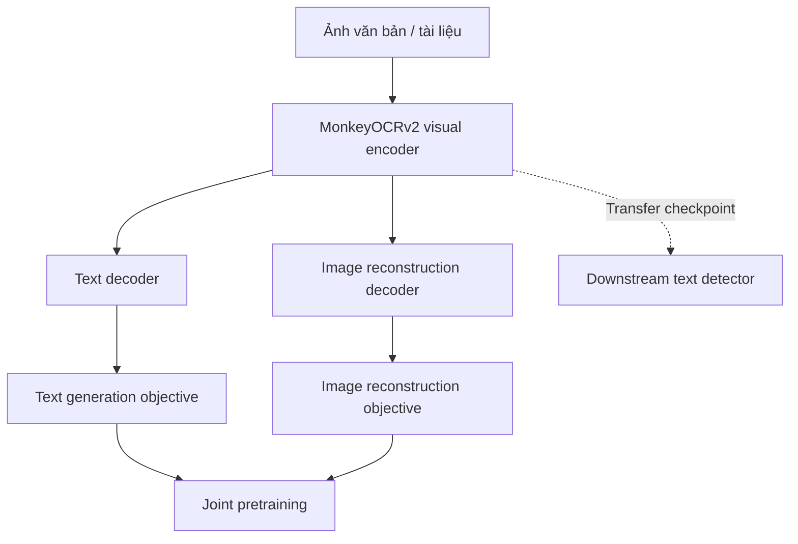
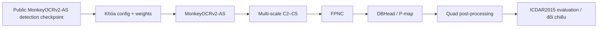
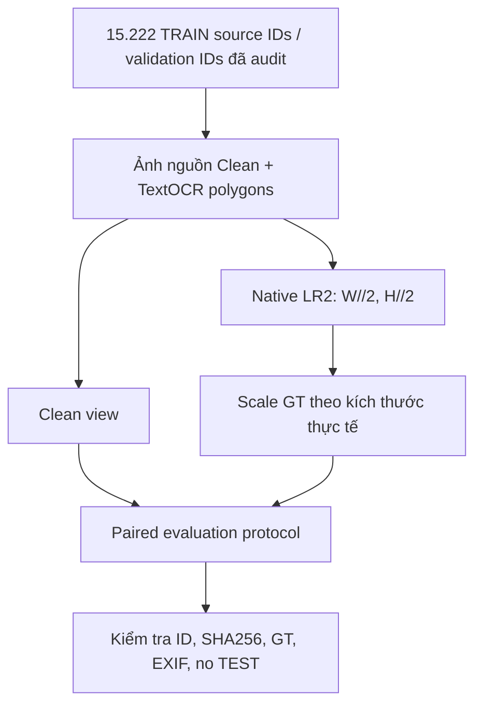
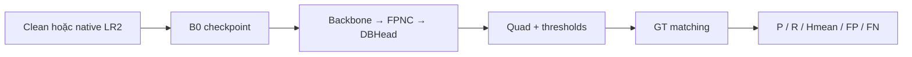
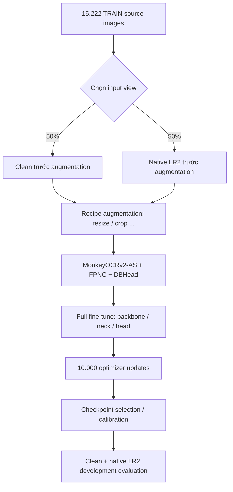
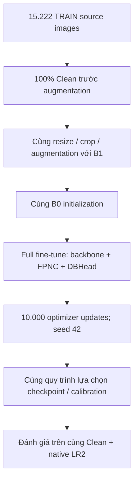
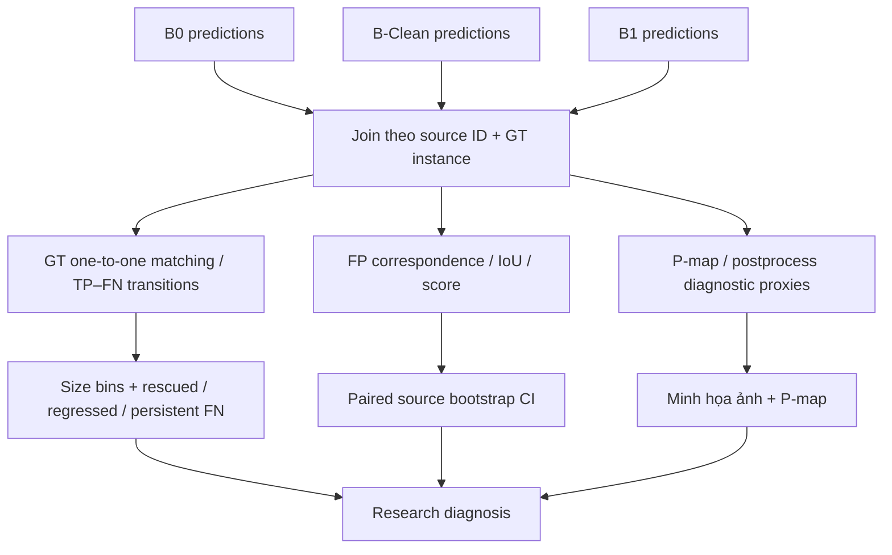
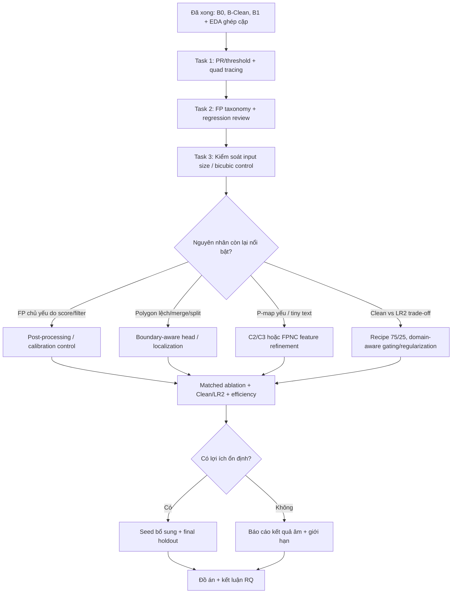

# BÁO CÁO TIẾN ĐỘ, KẾT QUẢ THỰC NGHIỆM VÀ ĐỊNH HƯỚNG NGHIÊN CỨU

> **BÁO CÁO LỊCH SỬ — MỐC 18/11/2026:** giữ để tra kết quả, giới hạn chứng cứ và các pilot trước. Phần roadmap/đề xuất phía dưới phản ánh thời điểm viết, không phải workflow triển khai mới nhất. Công việc Mix A/Mix B và phân công hiện dùng [kế hoạch phối hợp](Ke_hoach_phoi_hop_MixA_MixB_20261119.md). Nội dung/số liệu gốc bên dưới được giữ nguyên trong lần sắp xếp ngày 19/11.

## MonkeyOCRv2-based Scene Text Detection dưới suy giảm độ phân giải

**Phiên bản:** 18/11/2026  
**Phạm vi:** Text Detection trên ảnh TextVQA với nhãn định vị TextOCR; không thực hiện Text Recognition hay VQA reasoning.  
**Mô hình chính:** MonkeyOCRv2-AS (backbone) + FPNC (neck) + DBNet/DBHead; suy luận FP32; hậu xử lý `quad`.  
**Điều kiện nghiên cứu chính:** Clean và **native LR2**.  
**Trạng thái:** Đã có kiểm chứng checkpoint, benchmark, B1, B-Clean, EDA ghép cặp và các pilot; **chưa chốt hoặc chứng minh được một adapter cải tiến mới**.

> **Phạm vi chứng cứ:** Báo cáo tổng hợp từ kết quả job, bảng số liệu, nhận xét và quy ước protocol được cung cấp trong cuộc trao đổi. Những đường dẫn báo cáo trên máy tính/HPC chỉ được ghi lại để đối chiếu; không giả định đã trực tiếp đọc mọi artifact hoặc mã nguồn gốc. Các kết luận chưa được đo hoặc chưa qua đối chứng được ghi rõ là *giả thuyết/đề xuất*.

---

## 0. Tóm tắt điều hành

1. **Đã thực hiện partial reproduction/verification, không reproduce toàn bộ MonkeyOCRv2.** Nhóm sử dụng checkpoint công bố, tái dựng và kiểm chứng nhánh suy luận/đánh giá Text Detection (đối chiếu ICDAR2015). Nhóm không tái tạo MonkeyDoc v2, không pretrain visual encoder từ đầu và không reproduce mọi downstream task của paper.
2. **B0 → B1 đem lại mức tăng rất lớn trên LR2:** từ 61,95% lên 75,29% Hmean (+13,34 điểm) trên 2.262 nguồn remaining-validation, nhưng phần lớn lợi ích đó **không thể quy riêng cho LR2 training**.
3. **B-Clean giải thích phần quan trọng:** chỉ fine-tune trên Clean, cùng recipe và số update, đã đạt 74,36% LR2 Hmean (tăng +12,41 điểm so với B0). B1 chỉ hơn B-Clean **+0,93 điểm LR2 Hmean**, paired CI 95% **[-1,43; +3,14]**, chưa chứng minh một cải thiện Hmean tổng thể rõ ràng.
4. **B1 đem lại lợi ích nổi bật cho chữ cực nhỏ:** Recall vùng chữ cao <4 px trên ảnh LR2 tăng từ **19,31% (B-Clean) lên 45,02% (B1)**, tức +25,71 điểm. Nhưng LR2 FP tăng **10.457 → 16.487** (+6.030), LR2 Precision giảm **83,39% → 77,62%** (-5,77 điểm), Clean Hmean giảm **78,79% → 77,55%** (-1,24 điểm; CI hoàn toàn âm).
5. **Câu hỏi nghiên cứu mới:** Có thể **giữ lợi ích Recall chữ rất nhỏ của B1 nhưng giảm FP, cải thiện localization và bảo toàn chất lượng Clean** bằng một can thiệp nhẹ, có đối chứng hay không?
6. **Ưu tiên ngay:** PR/threshold analysis; phân loại FP, regression và polygon/P-map; đối chứng xử lý ảnh. Chỉ chọn C2/C3 adapter, FPNC gating, DBHead refinement hoặc điều chỉnh recipe nếu chẩn đoán hỗ trợ. LR4 nên là stress test **sau** khi giải thích LR2, chưa chuyển ngay thành bài toán huấn luyện chính.

---

## 1. Bối cảnh paper và giới hạn reproduction

### 1.1. Paper gốc thực hiện những gì?

MonkeyOCRv2 nghiên cứu họ visual encoder được pretrained hướng tới đặc trưng thị giác của văn bản/tài liệu. Pretraining sử dụng mục tiêu text generation và image reconstruction cùng các nguồn dữ liệu ảnh thực/tổng hợp. Encoder được chuyển giao sang nhiều downstream tasks; Text Detection chỉ là **một** nhánh đánh giá.



**Nguồn công khai để đối chiếu:**

- Paper: <https://arxiv.org/pdf/2607.11562v1>
- Repo của paper: <https://github.com/Yuliang-Liu/MonkeyOCRv2>
- Checkpoint detection: <https://huggingface.co/HB16888/MonkeyOCRv2_det>
- Repo nghiên cứu của nhóm: <https://github.com/ncat218/MONKEY_V2>

### 1.2. Chính xác nhóm đã reproduce phần nào?

| Thành phần | Đã thực hiện? | Cách mô tả học thuật phù hợp |
|---|---|---|
| Xây lại toàn bộ dữ liệu MonkeyDoc v2 | Không | Ngoài phạm vi |
| Pretrain MonkeyOCRv2 từ đầu | Không | Dùng trọng số công bố |
| Reproduce mọi downstream tasks | Không | Ngoài phạm vi |
| Thiết lập MonkeyOCRv2-AS + FPNC + DBNet | Có | Tái dựng nhánh detection downstream |
| Tải checkpoint, cố định weights/config/preprocess/evaluator | Có | Checkpoint-based replication/verification |
| Đánh giá đối chiếu với ICDAR2015 | Có | Kiểm chứng nhánh evaluation, không đồng nghĩa reproduce training |
| Chuyển giao sang ảnh TextVQA + TextOCR GT | Có | Thực nghiệm mở rộng do nhóm thiết kế |
| Phân tích native LR2, fine-tuning, EDA | Có | Đóng góp thực nghiệm của đồ án |
| Thiết kế/kiểm chứng một adapter mới | Chưa | Định hướng tiếp theo |

> **Cách viết được khuyến nghị:** “Partial reproduction and checkpoint-based verification of the MonkeyOCRv2-AS text detection pipeline, followed by a controlled investigation of low-resolution robustness on TextOCR.” Không viết “reproduced the entire MonkeyOCRv2 paper”.

---

## 2. Protocol, dữ liệu và cấu hình đã khóa

### 2.1. Dữ liệu và split

- Ảnh lấy từ hệ TextVQA; nhãn text regions/word-level polygon từ TextOCR.
- **TRAIN nội bộ:** 15.222 ảnh nguồn đã khóa, qua audit ID, SHA256, EXIF, GT và quy tắc tọa độ.
- **Remaining-validation:** 2.262 ảnh nguồn, sử dụng làm development/evaluation cho các số liệu trong báo cáo này.
- **TEST:** chưa dùng để lựa chọn model, ngưỡng hay đánh giá cuối.
- Có sự hiện diện của TextOCR trong các nguồn pretraining của MonkeyOCRv2: B0 **không phải** một encoder chưa từng tiếp xúc scene text/TextOCR. B-Clean đo tác động của fine-tuning trên **TRAIN nội bộ**, không phải lần đầu nhìn thấy miền dữ liệu.
- Các kết quả trên development đã chịu tác động từ lựa chọn checkpoint, ngưỡng hoặc quyết định thực nghiệm; không được trình bày là external/untouched test performance.

### 2.2. Định nghĩa chính xác điều kiện ảnh

**Clean:** Ảnh nguồn như cung cấp trong dữ liệu, *không mặc định là ảnh HR lý tưởng/sắc nét*.

**Native LR2 (nhánh chính):**

\[
W_{LR2}=W//2,\qquad H_{LR2}=H//2.
\]

- Downsample với kích thước đích **floor division**, không dùng `round(W/2)`.
- Kích thước đầu ra trực tiếp là `W//2 × H//2`, **không bicubic upscale trở lại** trong nhánh chính.
- Annotation polygon được biến đổi bằng tỉ lệ kích thước thực tế của ảnh đích, nhất là với chiều lẻ:

\[
s_x=\frac{W//2}{W},\quad s_y=\frac{H//2}{H},\quad
(x',y')=(s_x x,s_y y).
\]

- Giữ đúng interpolation, antialiasing, preprocessing, padding, coordinate rounding và inverse transform đã khóa trong code; không âm thầm thay pipeline.
- **LR2 + Bicubic upscale về Clean size:** chỉ là **nhánh đối chứng** được đề xuất/đã có hướng thí nghiệm, **không được gọi là native LR2**.
- **Native LR4:** chưa phải nhánh huấn luyện chính; chỉ đề xuất stress test với `W//4 × H//4` sau khi chẩn đoán LR2.

### 2.3. Mô hình, suy luận và đánh giá

| Thuộc tính | Cấu hình hiện tại |
|---|---|
| Backbone | MonkeyOCRv2-AS |
| Neck | FPNC |
| Head | DBNet / DBHead |
| Precision | FP32 |
| Post-processing | `quad` |
| So sánh chung trong các bảng chính | `mask_thr = 0.30`, `score_thr = 0.40` |
| Native threshold (phụ lục EDA cũ) | `0.30/0.30` |
| Calibrated | Mỗi model chọn từ **cùng lưới 15 cặp threshold** theo protocol khóa |
| Evaluation | P, R, Hmean; word-instance matching với GT; FP, FN, IoU, score, phân nhóm chiều cao chữ |
| CI | 2.000 paired bootstrap replicates theo **source image**, seed bootstrap `20261107` |

**Cẩn trọng về ngưỡng:** Ở bảng chính, B0 và B1 có số liệu common `0.30/0.40` cũng trùng kết quả calibrated đã báo cáo; **không tự suy diễn B-Clean cũng có cùng calibrated-optimal thresholds nếu chưa kiểm tra báo cáo chi tiết**. Báo cáo chính dưới đây dùng ngưỡng chung để tránh so sánh lẫn calibration.

### 2.4. Các phép đo và giới hạn

\[
P=\frac{TP}{TP+FP},\quad R=\frac{TP}{TP+FN},\quad
Hmean=\frac{2PR}{P+R}.
\]

Mọi chênh lệch như `+0,93`, `-1,24`, `+13,34` ở đây đều là **điểm phần trăm Hmean (percentage points)**, không phải % tương đối. Cặp Clean và LR2 phải được gắn với cùng source ID trong bootstrap; mỗi ảnh nguồn là một đơn vị lấy mẫu ghép cặp.

---

## 3. Các pipeline / workflow **đã thực hiện**

### 3.1. Pipeline A — Checkpoint-based partial reproduction



**Đã làm:** Khôi phục pipeline detection; kiểm tra checkpoint, evaluator, preprocessing, precision, hậu xử lý; đối chiếu benchmark ICDAR2015. **Không làm:** Re-train từ đầu backbone hoặc toàn bộ các downstream task của paper.

### 3.2. Pipeline B — Tạo benchmark Clean/native LR2



**Đã làm:** Audit split, ảnh nguồn, hash, GT, phép biến đổi tọa độ và đối chiếu counts; không dựng lại tập dữ liệu chỉ để phù hợp đề cương cũ.

### 3.3. Pipeline C — B0: Released checkpoint inference



**Mục đích:** Đường tham chiếu chưa fine-tune trên TRAIN nội bộ; đánh giá transfer và degradation gap.

### 3.4. Pipeline D — B1: Mixed-resolution fine-tuning



**Đã làm:** B1 full fine-tune, 50% Clean + 50% LR2, cùng nguồn TRAIN được khóa. Từ kết quả B1 ban đầu, nhóm tiến hành PRC, feature distillation và EDSR ở các pilot phụ.

### 3.5. Pipeline E — B-Clean: Clean-only fine-tuning đối chứng (job 48833)



**Đã làm:** Job **48833 COMPLETED** (2 giờ 26 phút). Đối chứng khớp B1 về checkpoint khởi tạo, source TRAIN, batch hiệu dụng, ngân sách, optimizer/LR/scheduler, augmentation và seed. **100% Clean không có nghĩa không có resize/crop**: vẫn giữ augmentation của B1. B-Clean kiểm tra **giá trị bổ sung của explicit native-LR2 training trên cùng nền augmentation**, không phân rã hai nguồn tăng Hmean độc lập tuyệt đối.

### 3.6. Pipeline F — EDA và chẩn đoán ghép cặp (jobs 48832, 48834)



- **Job 48832**: EDA B0/B1, COMPLETED (35 phút 30 giây), khớp counts lịch sử.
- **Job 48834**: EDA ba mô hình B0/B-Clean/B1, COMPLETED (23 phút 10 giây), phụ thuộc kết quả B-Clean.
- Đã đối chiếu toàn bộ counts tham chiếu và xuất **192 cặp ảnh/P-map minh họa**, các bảng chuyển dịch lỗi, IoU, score, size bins, FP và paired CI.
- Các ảnh minh họa được chọn theo quy tắc, **không phải mẫu ngẫu nhiên để suy rộng tần suất nguyên nhân**.

---

## 4. Kết quả định lượng chính — 2.262 nguồn remaining-validation

### 4.1. B0, B-Clean và B1 tại cùng ngưỡng `0.30/0.40`

| Mô hình | Training trên TRAIN nội bộ | Clean Hmean | Native LR2 Hmean | Native LR2 Precision | Native LR2 Recall | Native LR2 FP |
|---|---|---:|---:|---:|---:|---:|
| **B0** | Không fine-tune thêm | 73,30% | 61,95% | 87,94% | 47,81% | 5.129 |
| **B-Clean** | 100% Clean | **78,79%** | 74,36% | **83,39%** | 67,09% | **10.457** |
| **B1** | 50% Clean + 50% native LR2 | 77,55% | **75,29%** | 77,62% | **73,10%** | 16.487 |

**Các so sánh trực tiếp:**

| So sánh | Clean Hmean | LR2 Hmean | LR2 Precision | LR2 Recall | LR2 FP |
|---|---:|---:|---:|---:|---:|
| B-Clean − B0 | +5,49 pp | +12,41 pp | −4,55 pp | +19,28 pp | +5.328 |
| **B1 − B-Clean** | **−1,24 pp** | **+0,93 pp** | **−5,77 pp** | **+6,01 pp** | **+6.030** |
| B1 − B0 | +4,25 pp | +13,34 pp | −10,32 pp | +25,29 pp | +11.358 |

*Chênh lệch Hmean B1–B0 ở báo cáo EDA chính xác hơn theo số chưa làm tròn là +13,346 pp.*

### 4.2. Degradation gap (Clean Hmean trừ LR2 Hmean)

| Model | Gap |
|---|---:|
| B0 | 11,35 pp |
| B-Clean | 4,43 pp |
| B1 | 2,26 pp |

**Không diễn giải máy móc:** Gap nhỏ hơn chưa chắc là model tốt hơn toàn diện: gap có thể nhỏ vì chất lượng Clean giảm hoặc ngưỡng thiên về Recall. Phải xét **đồng thời Clean, LR2, Precision, Recall và FP**.

### 4.3. Paired 95% confidence intervals

| So sánh (new − old) | Clean Hmean Δ [95% CI] | LR2 Hmean Δ [95% CI] |
|---|---:|---:|
| B-Clean − B0 | **+5,49 [4,49; 6,46] pp** | **+12,41 [10,61; 14,40] pp** |
| **B1 − B-Clean** | **−1,24 [-2,06; -0,64] pp** | **+0,93 [-1,43; 3,14] pp** |
| B1 − B0 (EDA trước) | +4,250 [+3,079; +5,384] pp | +13,346 [+10,254; +16,329] pp |

- 2.000 paired bootstrap replicates theo ảnh nguồn; seed bootstrap `20261107`.
- CI của **B1 − B-Clean trên LR2 chứa 0**: chưa đủ cơ sở khẳng định hiệu quả Hmean tổng thể tăng rõ ràng ở điều kiện development này.
- CI của **B1 − B-Clean trên Clean hoàn toàn âm**: có bằng chứng mô tả nhất quán cho mức giảm Clean ở cặp checkpoint này.
- CI là **post-selection descriptive intervals**, không bao gồm biến thiên giữa training seeds; hiện mới có **một seed**. Không gọi đó là bằng chứng đã xác nhận khả năng tổng quát hóa cuối cùng.
- **Lưu ý S2:** báo cáo S2 trước đó ghi suy giảm **9,39 điểm Hmean**, CI `[3,86; 13,68]` trong một điều kiện riêng. Không trộn con số S2 với gap 11,35 pp của B0 trên **remaining-validation 2.262 nguồn** khi chưa đối chiếu model/split/calibration cụ thể.

### 4.4. Recall theo kích thước chữ trên **ảnh native LR2**

| Chiều cao GT trên LR2 | B0 Recall | B-Clean Recall | B1 Recall | B1 − B-Clean |
|---|---:|---:|---:|---:|
| **<4 px** | 1,03% | 19,31% | **45,02%** | **+25,71 pp** |
| 4–<8 px | 37,16% | 63,68% | **72,78%** | +9,10 pp |
| 8–<16 px | 62,06% | 76,67% | **78,99%** | +2,32 pp |
| ≥16 px | 58,67% | 72,72% | **72,91%** | +0,19 pp |

**Kết quả quan trọng:** Lợi ích Recall bổ sung từ explicit LR2 training tập trung mạnh ở nhóm chữ **<4 px**, giảm dần khi kích thước chữ tăng. Đây là **bằng chứng mô tả theo subgroup**, chưa có CI/kiểm định theo seed cho từng bin và không chứng minh module C2 là nguyên nhân.

### 4.5. Các pipeline/pilot phụ đã thử

| Phương án đã thử | Clean Hmean | LR2 Hmean | Ghi chú |
|---|---:|---:|---|
| B1-cal (mốc) | 77,55% | 75,29% | Mixed Clean/LR2 |
| PRC | 77,57% | 75,27% | Chưa vượt B1; hoạt động của mask thấp, còn cần chẩn đoán |
| B1 train tiếp (control) | 77,33% | 75,24% | Đối chứng cho distillation pilot |
| Feature distillation pilot | 77,32% | 75,24% | Không vượt train-tiếp control; mask activation báo cáo 95,15% |
| EDSR + B1-cal | Chưa đo | **75,89%** | Tăng quan sát +0,60 pp; FP và latency cao hơn; cần bicubic upscale cùng kích thước để cô lập lợi ích SR |

**Không kết luận quá mức:** PRC hoặc feature distillation **chưa đem lại lợi ích trong các cấu hình pilot đã thử**; điều đó không bác bỏ mọi biến thể PRC/distillation. Pilot feature distillation hướng dẫn feature hợp nhất của FPNC bằng teacher Clean; nó **không** phải thí nghiệm “C2/C3 adapter + distillation”. EDSR chưa có Clean metric và đối chứng bicubic đủ chặt nên không thể tuyên bố là lời giải cuối.

---

## 5. EDA chuyển dịch lỗi: mô hình đã học gì và đang đánh đổi gì?

### 5.1. B0 → B1 trên native LR2

| Loại chuyển dịch trên GT | Số lượng |
|---|---:|
| **Rescued** (B0 FN → B1 TP) | **20.891** |
| **Regressed** (B0 TP → B1 FN) | **1.112** |
| **Persistent FN** (B0 FN → B1 FN) | **19.931** |

- B1 cứu rất nhiều GT mà B0 bỏ sót; trong 20.891 ca rescued, **18.135** ca được gán nhãn “P-map phản hồi yếu trước đó” bởi quy tắc chẩn đoán.
- Tuy nhiên, lượng FP ở LR2 tăng **5.129 → 16.487**. Đây là **chênh lệch số FP tổng**, không mặc nhiên có nghĩa mọi FP tăng thêm là polygon mới, độc lập, không có correspondence.
- Trên Clean, EDA B0 → B1 ghi **11.672 rescued**, **1.837 regressed**, **14.729 persistent FN**.

### 5.2. B-Clean → B1 trên native LR2 (đối chứng then chốt)

| Loại chuyển dịch trên GT | Số lượng |
|---|---:|
| **Rescued** (B-Clean FN → B1 TP) | **6.150** |
| **Regressed** (B-Clean TP → B1 FN) | **1.453** |
| **Persistent FN** (cả hai FN) | **19.590** |
| **Tăng ròng TP** (rescued − regressed) | **+4.697** |
| **Tăng số FP** (B1 − B-Clean) | **+6.030** |

**Các phân nhóm chẩn đoán:**

- Trong rescued: 3.461 ca thuộc nhóm “P-map yếu ở B-Clean”, 2.375 ca thuộc nhóm “geometry”.
- Trong regressed: **1.209/1.453** ca thuộc nhóm “geometry” theo quy tắc.
- Trong **21.043 FN của B1** trên LR2: 10.599 ca P-map yếu và 9.407 ca geometry theo quy tắc. **Không coi hai nhãn này là nguyên nhân đã chứng minh hoặc hai tập hoàn toàn rời nhau**.

**Quan sát thực nghiệm:** B1 tăng nhạy với chữ nhỏ, cứu được nhiều GT hơn B-Clean nhưng trả giá bằng FP và một số localization regressions. EDA định lượng đã xác nhận các chuyển dịch; việc quy lỗi cho từng module cần kiểm tra P-map, polygons, score và post-processing sâu hơn.

### 5.3. Các dạng lỗi cần phân biệt (chưa kết luận nguyên nhân)

| Dạng quan sát | Diễn giải khả dĩ | Cách xác minh |
|---|---|---|
| Không có phản hồi P-map đáng kể gần GT | Đặc trưng nhận biết chữ chưa đủ mạnh / dữ liệu quá suy giảm | Xem P-map trước threshold, so B-Clean/B1, kiểm tra GT và cỡ chữ |
| Có P-map nhưng không còn polygon đầu ra | Ngưỡng, vùng nối, width filter hoặc `quad` có thể loại candidate | Trace từng bước DB post-processing |
| Có polygon nhưng IoU <0,5 | Lệch biên, split/merge instances hoặc GT khó | So polygon, overlap, union/split, score |
| Nhiều FP score thấp | Operating point/calibration chưa phù hợp | PR curves và threshold sweep trên dev |
| Nhiều FP score cao, hình giống chữ | Text-background discrimination chưa tốt | FP taxonomy, ảnh gốc và local score map |
| B1 đạt LR2 Recall cao nhưng Clean giảm | Trade-off do lựa chọn recipe/đặc trưng/quy tắc quyết định | Clean PR và phân tích regression B-Clean → B1 |

> **Quan trọng:** Một GT bị FN tại IoU 0,5 không chứng minh backbone “không nhìn thấy chữ”. Có thể đã có candidate bị loại hoặc polygon không khớp. Phải tách **recognition-of-text signal** khỏi **localization/post-processing** trước khi thiết kế adapter.

### 5.4. Các hình EDA hiện có và giới hạn

- Có **192 cặp ảnh/P-map minh họa** từ job EDA 48834, kèm overlay và chọn mẫu theo bin/chuyển dịch.
- Các ví dụ đã kiểm tra cho thấy: (i) B1 P-map mạnh hơn và cứu chữ; (ii) B1 score cao nhưng polygon lệch GT; (iii) cả hai IoU dưới 0,5.
- Đây là **evidence hình ảnh của hiện tượng**, không là ước lượng tần suất lỗi trong quần thể. Cần đánh giá mẫu ngẫu nhiên có phân tầng và ghi inter-review consistency nếu muốn đưa thành kết luận prevalence.

---

## 6. Kết luận có thể khẳng định và điều chưa được phép khẳng định

### 6.1. Có căn cứ từ kết quả đã đo

1. Fine-tuning Clean-only trên TRAIN nội bộ đã cải thiện mạnh cả Clean lẫn native LR2 so với B0 trong protocol báo cáo.
2. Mixed-resolution B1 tăng Recall, đặc biệt ở text cao <4 px và 4–<8 px trên LR2.
3. B1 có FP nhiều hơn và Precision thấp hơn B-Clean trên LR2, đồng thời Clean Hmean thấp hơn B-Clean.
4. LR2 Hmean B1 cao hơn B-Clean 0,93 pp theo điểm ước lượng; **CI ghép cặp chứa 0**.
5. Có nhiều rescued, regressed và persistent FN; phản hồi P-map và geometry diagnostics gợi ý nhiều hơn một họ vấn đề.

### 6.2. Chưa đủ bằng chứng để tuyên bố

- “B1 tốt hơn B-Clean một cách rõ ràng về Hmean LR2 trên quần thể/seed.”
- “Độ suy giảm chắc chắn nằm ở C2 hoặc do backbone.”
- “Các FP tăng đều do học quá nhạy với mọi nền ảnh.”
- “P-map yếu hoặc geometry proxy là nguyên nhân nhân quả đã xác thực.”
- “EDSR tốt hơn bicubic do khôi phục được nét chữ thực.”
- “Sự khác biệt giữa B-Clean và B1 là phép phân rã chính xác, độc lập của domain adaptation và resolution adaptation.”
- “Đã reproduce toàn bộ paper MonkeyOCRv2.”

---

## 7. Đặt lại vấn đề và câu hỏi nghiên cứu

### 7.1. Phát biểu bài toán mới

**Tiếng Việt:** *Phân tích ảnh hưởng của explicit native low-resolution training đến chất lượng phát hiện văn bản dựa trên MonkeyOCRv2, và tìm một cơ chế nhẹ giúp giữ lợi thế phát hiện chữ rất nhỏ đồng thời hạn chế False Positive, lỗi định vị và suy giảm hiệu năng trên ảnh Clean.*

**English:** *Understanding and Mitigating the Precision–Recall Trade-off in MonkeyOCRv2-based Low-Resolution Scene Text Detection.*

### 7.2. Main Research Question (MRQ)

> **Can the small-text recall gains from explicit native-LR2 training be retained while reducing false positives and preserving Clean detection performance, beyond what matched Clean-only fine-tuning and calibration can achieve?**

### 7.3. Các RQ có thể kiểm chứng độc lập

| RQ | Câu hỏi | Bằng chứng / thí nghiệm cần có |
|---|---|---|
| **RQ1 — Value of LR2 training** | Explicit native LR2 trong training đem lại lợi ích gì **ngoài** Clean-only fine-tuning với cùng augmentation? | B-Clean vs B1: CI Hmean, Recall theo chiều cao, FP, regression, Clean trade-off; thêm seed |
| **RQ2 — Failure mechanisms** | Sau B1, FP và FN còn lại chủ yếu do tín hiệu yếu, score/threshold hay geometry/quad post-processing? | P-map, raw candidates, step-by-step filtering, polygon IoU và FP taxonomy |
| **RQ3 — Low-cost baseline** | Chỉ hiệu chỉnh threshold/post-processing hoặc thay tỉ lệ Clean/LR2 có đạt trade-off tốt hơn không? | PR frontier, fixed operating points, 75/25 pilot nếu cần; Clean retention |
| **RQ4 — Mechanism improvement** | Một module nhỏ, chọn theo EDA, có hơn matched control và đủ cạnh tranh với B-Clean/B1 không? | Frozen/finetuned matched controls, same budget, paired CI, seeds, latency |
| **RQ5 — Generalization (phụ)** | Lợi ích và trade-off có duy trì khi tăng độ khó sang native LR4 không? | Stress test B0/B-Clean/B1; chỉ fine-tune LR4 nếu trở thành mục tiêu chính |

### 7.4. Các giả thuyết hiện tại (chưa phải kết luận)

- **H1:** LR2-aware training giúp tăng Recall ở các nhóm text kích thước rất nhỏ hơn hẳn lợi ích Hmean trung bình; đổi lại nhiều false detections và/hoặc sai lệch polygon.
- **H2:** Một phần trade-off của B1 có thể được giảm bằng lựa chọn operating point và hậu xử lý mà không thêm tham số học.
- **H3:** Sau khi loại trừ yếu tố post-processing, nếu text signal yếu tập trung ở một hoặc nhiều feature levels, một adapter nhẹ tại đó có thể cải thiện Recall/Precision trade-off.
- **H4:** Tối ưu đa điều kiện Clean–LR2 (qua sampling/regularization/gating) có thể giảm mất mát Clean nhưng phải được so sánh với thay đổi tỉ lệ dữ liệu đơn giản.

---

## 8. Lộ trình tiếp theo: Diagnose → Decide → Improve → Validate

### 8.1. Workflow đề xuất



### 8.2. Task 1 — PR curve, calibration và post-processing audit **(ưu tiên số 1)**

**Input:** Predictions/P-map B-Clean và B1 trên Clean và LR2, source IDs, GT, evaluator đã khóa.  
**Cần làm:**

1. Quét `mask_thr`, `score_thr` và những biến số quad có thể kiểm soát trên **development**; giữ cùng cơ chế chọn cho hai model.
2. Vẽ PR curves, Hmean–threshold, FP–Recall và **tiny-text Recall–FP**; báo cùng operating points thay vì chỉ mỗi model ở “best threshold”.
3. Lưu raw P-map, contours/candidates và lý do một candidate bị loại: threshold mask, score, width, unclip, quad/IoU.
4. Kiểm tra B1 có thể giảm FP mà vẫn giữ phần lớn Recall <4 px hay không; đo cả Clean để tránh chuyển trade-off sang điều kiện khác.
5. Không tune trên TEST; nếu quét nhiều cấu hình, giữ một dev-for-selection và final holdout chưa dùng.

**Deliverables:** `pr_curves.csv`, `threshold_frontier.csv`, `quad_filter_audit.csv`, `calibration_diagnostics.md`, các ảnh minh họa.

**Go/no-go:** Nếu thay đổi hậu xử lý đủ tốt, không bắt buộc xây adapter chỉ để giảm FP.

### 8.3. Task 2 — FP taxonomy, localization & regression review **(ưu tiên số 2)**

**Nhóm cần review:** (i) FP tăng từ B-Clean → B1; (ii) 1.453 regressions; (iii) 19.590 persistent FN; (iv) rescued dưới 4 px.

**Nội dung:**

- Ghép FP polygon giữa mô hình bằng IoU chỉ để mô tả nguồn tăng/giảm, không thay đổi official evaluator.
- Gắn nhãn: **background false alarm**, **polygon có chữ nhưng lệch GT**, **split/merge**, **duplicate**, **GT ambiguity/annotation issue**, **post-filter issue**, **unreadable tiny text**.
- Chọn mẫu **ngẫu nhiên có phân tầng** (size, score, transition, Clean/LR2), tách khỏi 192 ảnh được chọn để minh họa.
- Xuất confusion/taxonomy counts có mẫu số rõ; không nói “geometry chiếm X% tổng lỗi” nếu chỉ biết X% của một nhóm chuyển dịch.
- Với P-map, đo phản hồi vùng GT và vùng nền gần kề; proxy activation không tự chứng minh lỗi backbone.

**Deliverables:** `fp_taxonomy.csv`, `regression_review.csv`, `pmap_raw_candidates.csv`, `diagnosis_report.md`.

### 8.4. Task 3 — Kiểm soát scale và input-size (đối chứng chi phí thấp)

- Kiểm tra kích thước **sau preprocessing thực sự**, tensor backbone/FPNC, padding và phép biến đổi GT ở native LR2.
- Chạy **native LR2 vs LR2 + bicubic-upsample to Clean size** với checkpoint và postprocess cố định; không sửa benchmark native.
- Nếu dùng EDSR, so **EDSR vs bicubic** ở **cùng kích thước đầu ra** và đo FP/latency/quality; không quy 0,60 pp cho học phục hồi ảnh trước khi có control này.

**Deliverables:** `input_shapes_audit.csv`, `resize_controls.csv`, `edsr_vs_bicubic.md`.

### 8.5. Task 4 — Chọn đúng một phương án cải tiến

| Nếu EDA xác nhận | Can thiệp nên ưu tiên | Matched control tối thiểu |
|---|---|---|
| FP chủ yếu là score-threshold/postprocess | **Calibration / quad refinement** | B1 cùng checkpoint, cùng dev, đổi duy nhất postprocess |
| Polygon sai rõ, P-map vẫn có tín hiệu | **Boundary-aware DBHead / localization loss** | Fine-tune control cùng data và budget, không có head mới |
| Persistent tiny FN thiếu tín hiệu P-map, lỗi không giải quyết bằng postprocess | **C2 adapter hoặc C2+C3; kiểm tra FPNC** | Frozen backbone + trainable FPNC/head, no adapter vs adapter |
| B1 vs B-Clean trade-off ở Clean và LR2 | **75/25 Clean/LR2**, rồi mới gated/domain-aware adaptation | Cùng B0 initialization, 10k updates, same augmentation/budget |
| Lỗi thay đổi rõ theo scale và các stage | **Scale-aware FPNC refinement** | FPNC có/không module, cùng trainable components và capacity control nếu có thể |

**Nguyên tắc:** C2/C3 adapter là **ứng viên nghiên cứu**, chưa phải lựa chọn mặc định. Nếu EDA không xác nhận đặc trưng là nút thắt, không cố thêm adapter.

### 8.6. Task 5 — Ma trận thí nghiệm kiểm chứng công bằng

| ID | Phương án | Trạng thái | Câu hỏi trả lời |
|---|---|---|---|
| B0 | Original checkpoint | Hoàn thành | Mốc transfer và degradation |
| B-Clean | Full FT, 100% Clean, 10k | Hoàn thành | Giá trị Clean fine-tuning |
| B1 | Full FT, Clean/LR2 50/50, 10k | Hoàn thành | Giá trị bổ sung mixed-resolution |
| P0 | Threshold/quad controls | Cần làm có hệ thống | Có cần module học không? |
| R0 | 75/25 Clean/LR2 | Có điều kiện | Có giảm trade-off bằng recipe đơn giản không? |
| F0 | Frozen backbone; FPNC+DBHead train | Nếu chọn feature adapter | Matched frozen control |
| F1 | F0 + C2 adapter | Nếu EDA ủng hộ | Giá trị bổ sung của C2 |
| F2 | F0 + C2/C3 adapter | Chỉ sau F1 | Lợi ích thêm stage |
| D0 | DBHead control không refinement | Nếu chọn boundary | Matched head control |
| D1 | D0 + boundary refinement | Nếu EDA ủng hộ | Lợi ích với localization |
| S0 | Native LR4 inference B0/B-Clean/B1 | Stress test sau LR2 | Generalization khi tăng độ khó |

**Cố định khi so sánh có học:** same B0 initialization, 15.222 TRAIN IDs, data budget, update count, batch hiệu dụng, optimizer/LR/scheduler, augmentation, seed, checkpoint selection và calibration protocol. FPNC phải có cùng trạng thái **trainable/frozen** trong cặp control–adapter; một lựa chọn hợp lý là giữ **FPNC + DBHead trainable** ở cả hai và frozen backbone ở cả hai.

**So sánh đúng:** F1 > F0 là bằng chứng về giá trị của adapter **trong frozen regime**; F1 > B1 mới là cạnh tranh với full fine-tune mạnh. Nếu không hơn B1 nhưng giảm trainable parameters/training cost, có thể báo cáo đóng góp efficiency thay vì accuracy.

### 8.7. Task 6 — Validation và khóa kết quả

- Chọn mô hình/hyperparameters/ngưỡng trên development đã định nghĩa; **không tiếp tục lặp trên TEST**.
- Với phương pháp cuối, thêm ít nhất một training seed mới hoặc ghi rõ giới hạn một seed nếu tài nguyên không đủ.
- Báo paired CI của **proposed − matched control** trên Clean và LR2; không tái sử dụng CI từ B0/B1 để chứng minh adapter.
- Kiểm định Recall <4 px/4–8 px, FP, Precision, Hmean, Clean retention, latency, số trainable/total parameters, GPU memory; nên báo cả PR frontier.
- Thực hiện final holdout theo manifest/test protocol đã khóa và kiểm tra lại reproducibility/ICDAR2015 nếu cần; báo trung thực các pilot âm.

---

## 9. Khi nào mới nên chuyển LR4 thành nhiệm vụ chính?

**Chưa ngay.** Native LR4 hữu ích để khảo sát độ khó, nhưng không nên đổi mục tiêu chỉ vì LR2 đã khó vượt B1.

1. Trước tiên chẩn đoán LR2 và dùng LR4 như **zero-shot stress test** cho B0, B-Clean, B1.
2. Nếu LR4 cho thấy lỗi có tín hiệu còn khai thác được và là một điều kiện thực tế có ý nghĩa, mới cân nhắc mở nhánh fine-tuning.
3. Nếu train phương pháp mới trên LR4, phải có baseline **Clean + LR4 fine-tuning** cùng ngân sách, không so phương pháp LR4-trained với B1 chỉ được train Clean + LR2 để quy lợi ích cho adapter.
4. Vẫn báo Clean và LR2 để kiểm tra khả năng tổng quát hóa/trade-off.

---

## 10. Tiêu chí đánh giá cải tiến và các rủi ro học thuật

### 10.1. Định nghĩa thành công trước khi nhìn kết quả

Một phương pháp nên được coi là đáng giữ khi:

- Tăng Hmean LR2 **so với matched control** hoặc cung cấp điểm Precision–Recall trade-off vượt trội ở mức Recall chữ rất nhỏ mục tiêu;
- Không làm giảm Clean Hmean quá mức đã xác định trước;
- Mức tăng có CI/seed phù hợp, không chỉ là chênh lệch vài phần mười điểm trên một checkpoint;
- Overhead về latency/parameters được đo và chấp nhận được;
- Có thể quy cải thiện cho module/recipe thay vì threshold, kích thước ảnh hoặc training budget khác nhau.

*Có thể đặt ngưỡng mục tiêu thực dụng, chẳng hạn cải thiện ≥0,5 pp Hmean LR2 và không mất Clean quá 0,5 pp, nhưng chỉ nên chốt dựa vào mục tiêu và độ bất định thực nghiệm; không coi đây là quy tắc thống kê phổ quát.*

### 10.2. Rủi ro phải khai báo

1. **Train/validation provenance:** TextOCR có thể từng xuất hiện trong nguồn pretraining của MonkeyOCRv2; không gọi các ảnh nội bộ là hoàn toàn unseen với backbone nếu chưa audit provenance.
2. **Development reuse:** Remaining-validation, S1/S2 đã tham gia quá trình lựa chọn/quyết định; CI trên chúng mang tính descriptive, cần final holdout.
3. **Single training seed:** CI bootstrap theo source không mô tả thay đổi do random initialization/order/augmentation giữa training runs.
4. **Annotation ambiguity:** Những text word nhỏ, mờ, không khớp polygon có thể tạo FP/FN khó diễn giải; review GT trước khi kết luận lỗi mô hình.
5. **Small-text subgroup:** Chia bin theo chiều cao chữ ở *ảnh native LR2*, cố định định nghĩa; Precision theo từng bin cần quy tắc gán FP rõ ràng, không tự tính từ GT-only recall bins.
6. **Threshold confounding:** Phải ghi common/native/calibrated và quy tắc chọn ngưỡng; không so hai mô hình ở hai operating points khác mà không nói rõ.
7. **Input-size confounding:** Native LR2 thay đổi cả thông tin pixel và độ lớn spatial features; bicubic upscale chỉ là control một phần, không phân rã hoàn toàn tác động.
8. **Diagnostic proxies:** P-map weak/geometry là heuristic, có thể chồng lấn; không phải causal explanation.
9. **Selection of visual examples:** 192 cặp ảnh/P-map minh họa không phải mẫu ngẫu nhiên đại diện.
10. **Partial reproduction:** Đã reproduce/verify downstream inference/evaluation; không mô tả là reproduce pretraining hoặc tất cả kết quả paper.

---

## 11. Đề xuất cấu trúc báo cáo đồ án cuối cùng

1. **Introduction** — Scene Text Detection; vấn đề native low-resolution; động lực từ B0/B-Clean/B1.
2. **Related Work** — MonkeyOCRv2 visual pretraining, DBNet, small-text/low-resolution detection, multi-resolution training, confidence calibration, feature refinement.
3. **Partial Reproduction & Experimental Protocol** — Công khai phạm vi checkpoint verification, ICDAR2015, TextVQA/TextOCR, split, native LR2, augmentation, evaluator.
4. **Baselines & Fine-tuning** — B0, B-Clean, B1; matched 10k training recipe và calibration.
5. **Quantitative & Paired EDA** — P/R/Hmean, CI, size recall, transitions, FP, polygon/Iou, P-maps.
6. **Failure Diagnosis & Hypothesis** — Score vs localization vs representation; bằng chứng hỗ trợ/không hỗ trợ.
7. **Proposed Intervention** — Chỉ một hướng chính, với sơ đồ module rõ ràng, loss và training/inference path.
8. **Controlled Ablations & Efficiency** — matched control, Clean retention, tiny-text recall, PR curves, costs, seeds.
9. **Limitations & Conclusion** — Negative pilots, provenance, held-out result, câu hỏi còn mở.

### Đóng góp nghiên cứu có thể viết ngay, không phụ thuộc adapter

- Một **protocol** nhất quán để kiểm tra MonkeyOCRv2-based Text Detection trên Clean và native LR2 với word-level TextOCR GT.
- **Đối chứng Clean-only vs mixed-resolution**, chỉ ra mức tăng recall chữ cực nhỏ nhưng đánh đổi Precision, FP và Clean performance.
- **Paired error analysis** ở mức word-instance trên cùng nguồn ảnh, gồm rescued/regressed/persistent FN, IoU, P-map và bootstrap CI.

### Đóng góp dự kiến, chưa được khẳng định

- Một cơ chế cải tiến nhẹ **do EDA lựa chọn** để cải thiện trade-off small-text Recall/FP/Clean, kèm đối chứng, ablation và efficiency.

---

## 12. Tài nguyên và vết thực nghiệm để đối chiếu

**Jobs:**

| HPC job | Nội dung | Trạng thái | Ghi chú |
|---|---|---|---|
| `48832` | EDA B0 vs B1 | COMPLETED | 35m30s; counts lịch sử khớp |
| `48833` | B-Clean 100% Clean, 10k updates | COMPLETED | 2h26m |
| `48834` | EDA B0/B-Clean/B1 | COMPLETED | 23m10s; 192 ảnh/P-map pairs |

**Một số artifact đã được nêu trong báo cáo job:**

- `paired_transitions.csv`
- `fp_analysis.csv`
- `model_metrics.csv`
- `stratified_metrics.csv`
- `failure_distributions.json`
- `selected_examples.json`
- `examples/`
- `input_shapes.csv`

**Đường dẫn báo cáo cục bộ đã được cung cấp** (phụ thuộc máy và repo, không phải tài liệu được đính kèm trong phiên này):

```text
C:/Users/ADMIN/Documents/CS431/ĐỒ ÁN/CS431-Monkey-LowRes/.runtime/bclean-review-48833/bclean_report.md
C:/Users/ADMIN/Documents/CS431/ĐỒ ÁN/CS431-Monkey-LowRes/.runtime/eda-review-48834/eda_report.md
C:/Users/ADMIN/Documents/CS431/ĐỒ ÁN/CS431-Monkey-LowRes/.runtime/eda-review-48832/eda_report.md
```

Tài liệu triển khai liên quan trên GitHub: <https://github.com/ncat218/MONKEY_V2/blob/main/docs/bclean-and-paired-eda.md>.

---

## 13. Kết luận chốt cho nhóm và người hướng dẫn

**Vấn đề không còn đơn giản là “MonkeyOCRv2 giảm gần 10% trên LR2, hãy thêm adapter tăng Recall”.** Sau khi bổ sung B-Clean, ta biết:

- Fine-tuning Clean-only **đã chuyển giao rất mạnh sang native LR2** trong điều kiện augmentation hiện tại.
- Explicit LR2 training trong B1 có lợi ích rõ **về mô tả Recall cho chữ rất nhỏ**, nhưng Hmean LR2 chỉ hơn B-Clean 0,93 pp với CI chứa 0.
- B1 đánh đổi bằng **+6.030 FP, −5,77 pp Precision trên LR2 và −1,24 pp Clean Hmean**.
- Các lỗi P-map và geometry cho thấy cần **chẩn đoán tầng quyết định và localization** trước khi thiết kế adapter feature.

**Hướng thực hiện kế tiếp được chốt:**

> **PR/threshold & quad audit → phân loại FP/regression/P-map → bicubic/scale control → chọn một can thiệp được chứng minh là cần thiết → matched ablation + CI/seeds → final holdout.**

Đây là lộ trình có thể cho kết luận khoa học giá trị **ngay cả khi adapter không cải thiện**: xác định được explicit native-LR2 training giúp ở đâu, đánh đổi ở đâu, và liệu một cơ chế mới có giải quyết phần hạn chế thực tế sau fine-tuning hay không.
