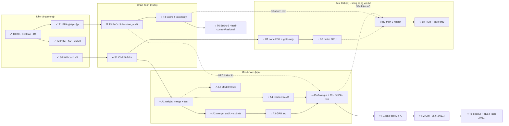

# Pipeline chung: Tuấn + Mix A/B (bản tĩnh để gửi Tuấn)

Bản có thể tick trực tiếp nằm ở `index.html` (cùng thư mục, đọc trạng thái từ `status.js`).

**Song song hóa:**
- Ngày 21/11, job GPU A3 của Mix A chạy nền.
- 2 giờ công hôm đó dành để code và probe Mix B (B1, B2). Probe không phụ thuộc taxonomy.
- Chỉ bước train B3 bị chặn bởi T4 (taxonomy của Tuấn) và A5 (kết quả Mix A).
- Ký hiệu: `✓` xong · `●` đang làm · `○` chưa làm · `⏳` chờ · `◇` có điều kiện.
