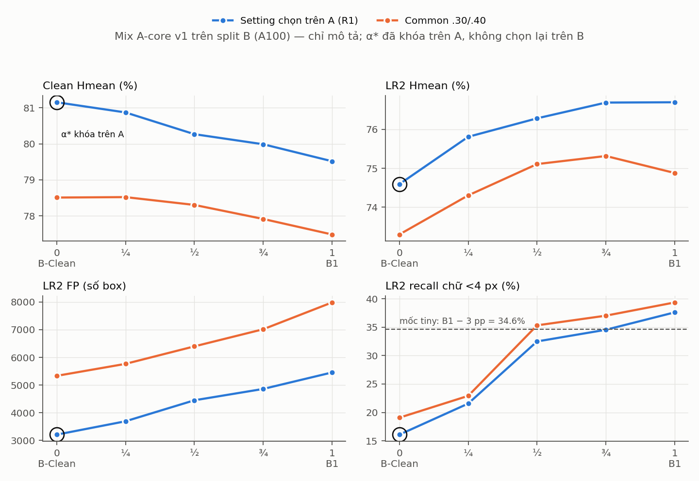

# Báo cáo Mix A-core v1: nội suy trọng số B-Clean ↔ B1 (kết quả âm) · 21/11/2026

Người thực hiện: Trí. Pipeline, baseline và tiêu chí: Tuấn. Phạm vi: **Text Detection**, ảnh Clean và native LR2.

## 1. Tóm tắt

- **Kết luận chính:** theo quy tắc đã khóa (R1, chọn trên A rồi đánh giá trên B), α\* = **B-Clean (α = 0, một endpoint)**. Vì vậy **Mix A-core v1 chưa vượt baseline theo tiêu chí đã khóa**.
- **Hai hướng khám phá sau v1** cũng chưa tạo căn cứ đủ mạnh để đi tiếp:
  - Đổi cách chọn (ràng buộc tiny): ứng viên tốt nhất vẫn trượt cả +0,5 pp lẫn mốc tiny. Ở cùng recall, nó còn nhiều FP hơn B1.
  - Chẩn đoán BN: không thấy sai lệch BN đáng kể riêng do phép trộn, trong cách đo đã dùng.
- **Đóng Mix A v1 là hoàn tất một thí nghiệm có kết quả âm**, không có nghĩa bỏ mục tiêu cải tiến.
- `VERIFIED` ở đây chỉ xác nhận tái lập trên cùng GPU. Test phần mềm PASS chỉ xác nhận các kiểm tra phần mềm. Không cái nào chứng minh phương pháp có hiệu quả.

## 2. Câu hỏi và phương pháp

**Hai baseline có đánh đổi.** Bảng của Tuấn, trên toàn bộ remaining-validation và hậu xử lý mở rộng, chạy trên H200. Đây **không** phải số split B trên A100.

| Model | Clean Hmean | LR2 Hmean | LR2 FP | Recall LR2 <4 px |
|---|---|---|---|---|
| B-Clean (100% Clean) | 80,86% | 75,51% | 6.578 | 15,96% |
| B1 (50/50 Clean/LR2) | 79,43% | 76,90% | 11.997 | 45,79% |

**Mix A-core:** W_α = (1 − α)·W_B-Clean + α·W_B1, với α ∈ {0, ¼, ½, ¾, 1}. Không train lại detector. Ý tưởng lấy cảm hứng từ WiSE-FT, và không có bảo đảm checkpoint ở giữa tốt hơn hai đầu.
- Endpoint giữ nguyên `state_dict` gốc.
- Tensor float được trộn bằng float64 rồi đổi lại kiểu cũ.
- Thống kê BN được nội suy, không ước lượng lại.
- `num_batches_tracked` lấy từ B1.

Nguồn: `mixab/weight_merge_janek.py`, `merge_manifest.json`.

**Đánh giá:** 2.262 nguồn remaining-validation × (Clean, native LR2) × lưới hậu xử lý 9 geometry × 8 score = 72 setting. Batch 1, FP32, cùng code `rev4.stage_a` của Tuấn, MONKEY_V2 `dc19b85`.

**Quy tắc đã khóa, Tuấn xác nhận ngày 20/11** (kế hoạch §4.2):
1. Chia nguồn theo SHA-256 của source ID: A có 1.130 nguồn, B có 1.132; Clean/LR2 của cùng nguồn luôn cùng split.
2. Trên A, mỗi model chọn setting tối đa Hmean Clean + LR2 (tie-break: native `.30/.30`, rồi thứ tự lưới). Chọn α\* trong cả 5 model, endpoint vẫn được tham gia.
3. Khóa lựa chọn rồi đánh giá trên B. α\* chỉ đi tiếp nếu thỏa cả ba điều kiện:
   - là α ở giữa;
   - mean Hmean trên B vượt **cả hai** baseline ít nhất 0,5 pp;
   - recall LR2 <4 px ≥ recall của B1 trên B − 3 pp.

   Cả hai ngưỡng là ngưỡng thực dụng.
4. Báo paired CI theo nguồn: 2.000 lượt bootstrap, seed 20261107, Clean/LR2 cùng nguồn.

## 3. Kiểm chứng

User chỉ có T4/A100. Theo phương án (a) Tuấn chọn (kế hoạch §4.3), cả 5 model chạy trong **cùng một job trên A100-SXM4-40GB**, và mọi so sánh đều dùng endpoint của chính job đó.

| Cổng | Kết quả |
|---|---|
| P-map endpoint (20 ảnh, ≤ 1e-6) | PASS, sai khác 0,0 |
| Tái lập cùng GPU (counts 11 cột của endpoint so với probe phiên trước, 40 nguồn) | PASS, 0/5.760 ô lệch |
| Trạng thái | `VERIFIED` theo chính sách `same_gpu_endpoints` |
| Độ lệch so với H200 (chỉ báo cáo) | 3,1–3,4% ô lệch ±1–7 polygon; `gt` không lệch ô nào; \|ΔHmean\| toàn cohort ≤ 0,023 pp |

Thời gian: 5 model tốn khoảng 2,7 giờ wall trên A100, 0,41–0,43 s/task.

## 4. Kết quả v1

**Chọn trên A** (tổng Hmean Clean + LR2):

| Model | Setting chọn | Tổng trên A |
|---|---|---|
| **B-Clean (α 0)** | `mask_040/score_0.60` | **157,016** |
| α ¾ | `epsilon_005/score_0.50` | 156,600 |
| α ½ | `epsilon_005/score_0.50` | 156,518 |
| α ¼ | `mask_040/score_0.60` | 156,353 |
| B1 (α 1) | `epsilon_005/score_0.50` | 156,332 |

α\* = B-Clean, nên dừng: "Mix A chưa thắng theo quy tắc đã khóa".

**Trên B, đã khóa.** Chỉ α\* được xét; các dòng khác chỉ để mô tả.

| Model | Clean H | LR2 H | Mean H | LR2 FP | Clean FP | Tiny LR2 <4 px |
|---|---|---|---|---|---|---|
| **B-Clean (α\*)** | 81,16 | 74,59 | **77,87** | 3.211 | 5.636 | 16,08% |
| α ¼ | 80,87 | 75,81 | 78,34 | 3.694 | 6.042 | 21,55% |
| α ½ | 80,27 | 76,28 | 78,28 | 4.451 | 6.271 | 32,50% |
| α ¾ | 79,99 | 76,69 | 78,34 | 4.861 | 6.491 | 34,56% |
| B1 | 79,52 | 76,69 | 78,11 | 5.456 | 6.728 | 37,63% |

*Hình: chỉ mô tả. α\* (khoanh tròn) được khóa trên A. Đường xanh là setting mỗi model tự chọn trên A; đường cam là common `.30/.40`. Nguồn: `docs/handoff/artifacts/janek/mix_a_v1/evaluation_B_janek.csv`; vẽ bằng `scripts/plot_alpha_curve_janek.py`.*

**CI paired 95% của chênh lệch mean Hmean (pp), trên B, tại setting đã khóa:**

| α ở giữa | so với B-Clean | so với B1 |
|---|---|---|
| ¼ | +0,47 [−0,04; 0,90] | +0,23 [−0,78; 1,42] |
| ½ | +0,40 [−0,42; 1,26] | +0,17 [−0,40; 0,98] |
| ¾ | +0,46 [−0,53; 1,48] | +0,23 [−0,12; 0,71] |

Không α nào đạt +0,5 pp so với cả hai baseline, và mọi CI đều chứa 0. Thứ tự hai endpoint đảo giữa A và B: B-Clean dẫn khoảng 0,34 pp trên A, B1 dẫn 0,24 pp trên B. Mọi chênh lệch ở đây đều nhỏ hơn độ phân giải của tập development này.

## 5. Khám phá 1: chọn có ràng buộc tiny trên A (E-sel)

Luật được ghi ở kế hoạch §4.4 trước khi chạy:
- Trên A, loại cấu hình có tiny thấp hơn B1 (setting R1) quá 3 pp, tức dưới 45,82%.
- Trong các cấu hình còn lại, chọn mean Hmean cao nhất.

B đã được xem từ v1, nên mọi số trên B ở phần này **chỉ là khám phá**.

- B-Clean và α ¼ không có setting khả thi nào. α\* = α ¾.
- Trên B, α ¾ vẫn trượt: +0,23 pp so với B1 và +0,46 pp so với B-Clean, tiny thấp hơn B1 3,07 pp.
- **FP ở cùng recall LR2** (setting có ít FP nhất trên A trong số các setting có recall ≥ recall của B1): α ¾ có 7.163 / 5.781 FP, B1 có 6.685 / 5.456 (A / B), tức α ¾ **nhiều hơn** 6–7%. Mức "giảm 11% FP" ở bảng v1 vì vậy đến từ recall thấp hơn.
- Kết luận: đổi cách chọn **không** tạo ra ứng viên đạt mục tiêu. Đây là sửa cách chọn, không làm model mạnh hơn.

Chi tiết: `docs/handoff/artifacts/janek/explore_sel_v1/NOTES_janek.md`.

## 6. Khám phá 2: chẩn đoán BN sau khi trộn (E-BN Giai đoạn 0)

- **Giả thuyết:** thống kê BN nội suy có thể không khớp model trộn. Căn cứ là tài liệu PyTorch về `AveragedModel` / `update_bn`.
- **Cách làm:** chỉ đo, không sửa model.
  - 2 lớp BN có tác dụng lúc inference (`det_head.binarize.1/.4`).
  - 1.000 nguồn TRAIN × (Clean, LR2). Danh sách TRAIN Tuấn công bố ở `e4a2a89`.
  - Đo cả 5 model; endpoint là đối chứng.
  - Chạy trên Colab **T4**. Cả 5 model đo cùng điều kiện, nên phép so sánh giữa chúng có giá trị. Đây là chẩn đoán BN, không phải điểm chất lượng để so với số A100.
- **Kết quả:**
  - Lệch giữa thống kê đã lưu và đo được (`binarize.1`, z trung bình): α ở giữa 0,157–0,159, endpoint 0,158–0,161.
  - Thống kê đo được của α ở giữa chỉ cách nội suy từ hai endpoint ≤ 0,005 SD trung bình.
  - **Trong cách đo này, chưa thấy sai lệch đáng kể do phép trộn.** Điều đó không chứng minh BN hiện tại là tối ưu cho phát hiện chữ.
- **Lệch nền chung ở mọi model**, kể cả endpoint gốc: phương sai đo được bằng khoảng 0,45 lần phương sai đã lưu.
  - Phương pháp đo có giới hạn: phương sai lấy trong từng ảnh có thể khác cách BN tính lúc train (micro-batch 2 ảnh, có augmentation). Vì vậy con số này **không tự chứng minh pipeline có lỗi**.
  - Cập nhật BN theo thống kê đo hiện tại có thể làm thay đổi đáng kể cả endpoint. Chưa biết thay đổi đó tốt hay xấu.
- **Quyết định (21/11): không mở Giai đoạn 1**, vì bằng chứng chưa đủ để ưu tiên hướng này.

Chi tiết: `docs/handoff/artifacts/janek/bn_stage0_v1/NOTES_janek.md`.

## 7. Giới hạn

- A/B thuộc remaining-validation đã ảnh hưởng tới nhiều quyết định trước, nên B **không phải holdout mới**. Chia lại dữ liệu này cũng không tạo ra tập kiểm chứng mới.
- Một seed huấn luyện cho mỗi endpoint. CI là mô tả sau khi chọn, và không đo được biến thiên giữa các seed.
- Số A100 chỉ so trong cùng job. Bảng H200 toàn cohort ở §2 không trừ trực tiếp được với số split B.
- Ngưỡng +0,5 pp và mốc tiny là ngưỡng thực dụng để quyết định đi tiếp, không phải tiêu chuẩn chứng minh cải tiến.
- Hàm chọn của R1 (tổng Hmean) không thưởng cho tiny recall, trong khi tiêu chí đi tiếp có xét tiny. E-sel đã xem lại điểm này, và kết luận không đổi.

## 8. Kết luận và bước tiếp

Đã kiểm ba hướng: trộn nguyên bản, đổi cách chọn, chẩn đoán BN. Không hướng nào tạo căn cứ đủ mạnh để tiếp tục bỏ GPU vào phép trộn trọng số. Nhóm nên chuyển sang hướng có cơ hội làm model mạnh hơn, thay vì tiếp tục cố cứu phép trộn.

**Hướng latent của Tuấn** (đọc ở MONKEY_V2 `ae947e9`; mình chưa thấy file kết quả):
- Ba nhánh khởi tạo từ B1, chỉ train DBHead hoặc DBHead + adapter sau FPNC: A0 head, A1 plain residual, A2 gated residual. Backbone và FPNC đóng băng.
- Pilot 1.000 update (job 81918) được ghi là cho chênh lệch adapter/đối chứng **gần bằng 0** và chưa chứng minh hiệu quả (`docs/latent-10k-extension.md`). Tuấn đã thêm bản 10.000 update; chưa có kết quả.
- **Liên hệ với Mix B của mình:** nhánh A1 của Tuấn gần với control "Residual" trong kế hoạch Mix B (§5.2). FSR và gate-only có thể là hai nhánh bổ sung trên cùng recipe, với A0/A1 làm đối chứng.
  - Đây là **đề xuất**, chưa bàn với Tuấn.
  - Hợp lý nhất là chờ kết quả 10.000 update. Nếu A1/A2 vẫn không hơn A0, kỳ vọng của FSR cũng thấp. Nếu có tín hiệu, mới thống nhất thân R, recipe và tiêu chí trước khi viết code Mix B.

## 9. Tái lập

| Bước | Lệnh hoặc notebook | Đầu ra |
|---|---|---|
| Trộn trọng số | `python -m mixab.weight_merge_janek …` (Ô 3 của notebook v1) | `merge_weights_v1/` + `merge_manifest.json` |
| Môi trường + probe + A2r + chọn lại | `notebooks/colab_E1_A2_probe_janek.ipynb`, Ô 1–8, A100 | `docs/handoff/artifacts/janek/mix_a_v1/` |
| Chọn lại ở local với mốc tiny đã khóa | `python -m mixab.reselect_split_janek --spec docs/handoff/artifacts/janek/mix_a_v1/reselect_spec_local_janek.json --output …` | `decision_janek.json` |
| E-sel | `python -m mixab.explore_selection_janek --spec docs/handoff/artifacts/janek/mix_a_v1/reselect_spec_local_janek.json --output …` | `docs/handoff/artifacts/janek/explore_sel_v1/` |
| E-BN Giai đoạn 0 | `notebooks/colab_bn_pilot_stage0_janek.ipynb`, Ô 1–4, B1–B4 | `docs/handoff/artifacts/janek/bn_stage0_v1/` |
| Hình | `python scripts/plot_alpha_curve_janek.py` | `docs/handoff/artifacts/janek/mix_a_v1/alpha_curve_B_janek.png` |

NPZ đầy đủ, checkpoint và log nằm trên Drive `MyDrive/CS431_MixA/`, không có trong Git.
