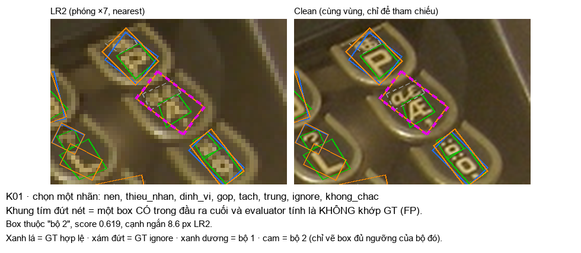
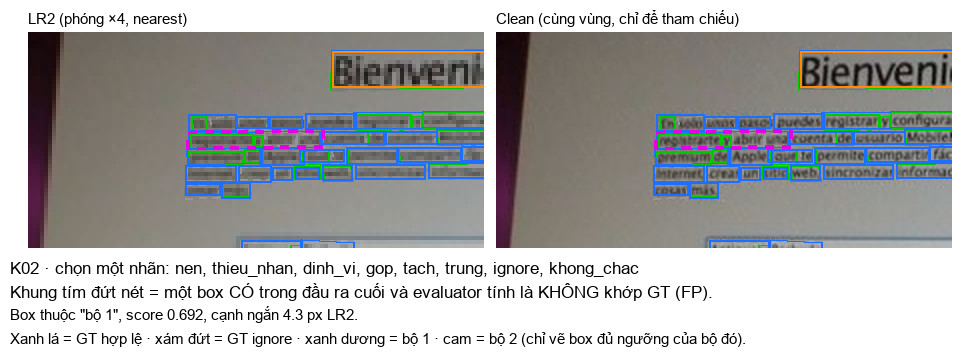
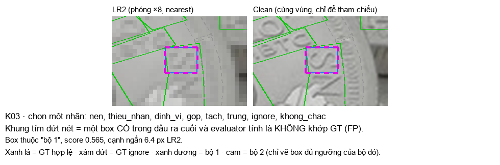
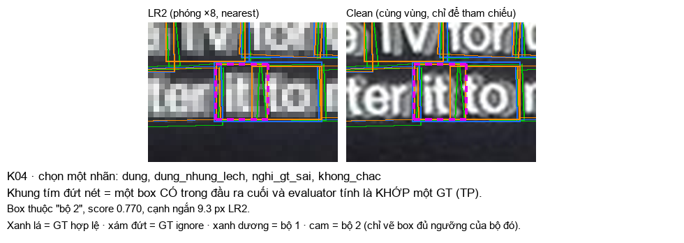
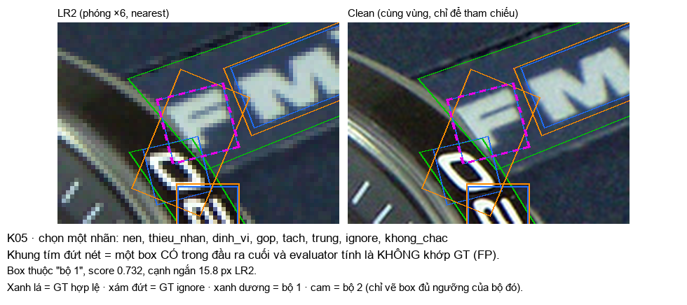
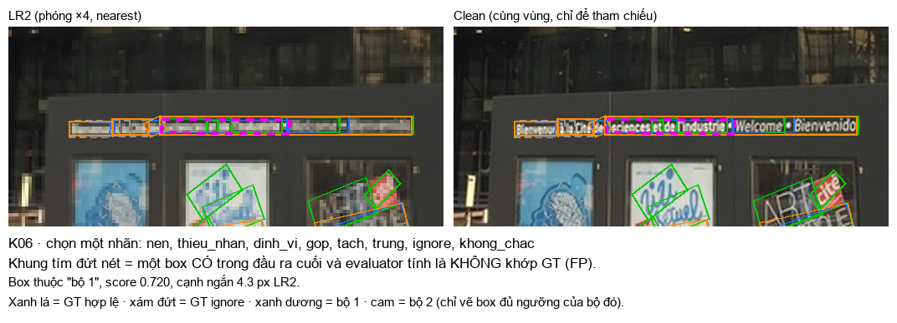
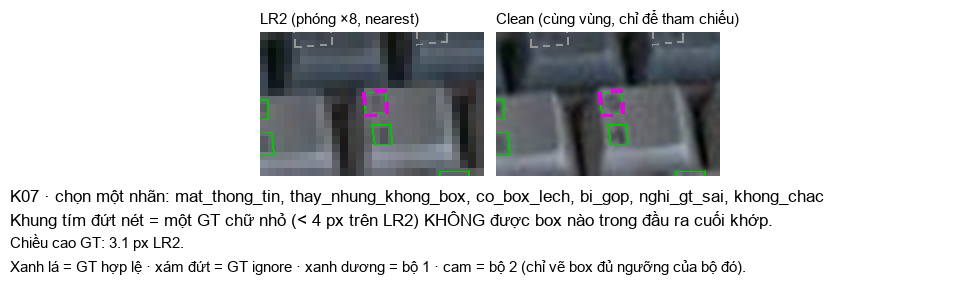
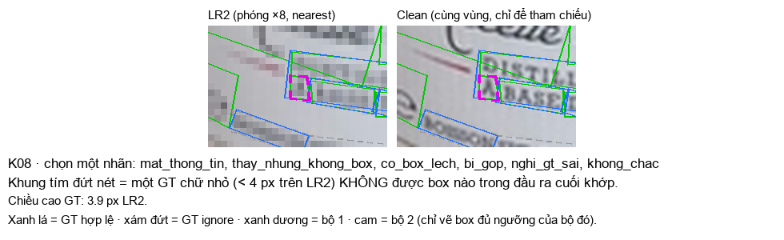
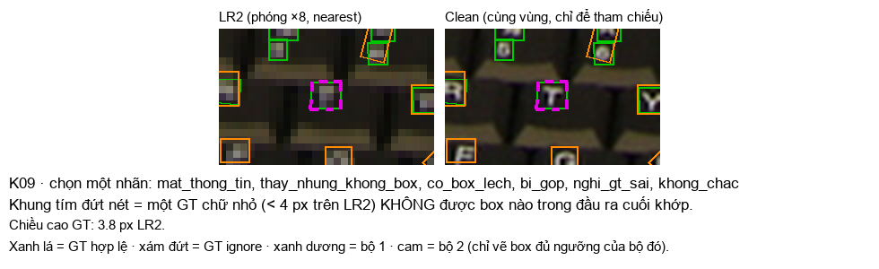
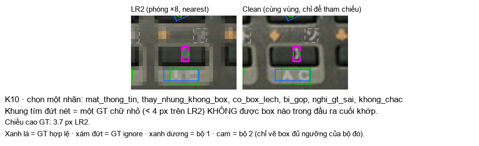

# Hướng dẫn chấm thẻ Phase 0 · CS-B1@0.7

**Đợt này: chỉ 10 thẻ hiệu chuẩn (K01–K10).** Các thẻ này lấy từ split B và **không tính vào thống kê**. Chấm xong, gửi lại phiếu cho Claude. Hai bên thống nhất cách hiểu nhãn rồi mới mở 70 thẻ chính (C01–C70, split A).

## Cách đọc một thẻ
- **Trái:** ảnh LR2 phóng to kiểu nearest (thấy rõ từng pixel). **Phải:** ảnh Clean của cùng vùng, chỉ để tham chiếu.
- **Khung tím đứt nét:** đối tượng cần chấm. Dòng chữ dưới ảnh nói nó là box dự đoán hay GT.
- **Xanh lá:** GT hợp lệ. **Xám đứt nét:** GT ignore.
- **Xanh dương = "bộ 1", cam = "bộ 2":** box của hai bộ dự đoán. Chỉ vẽ box đủ ngưỡng của bộ đó. Màu được gán ngẫu nhiên theo từng thẻ, nên đừng đoán bộ nào là model nào.
- Ảnh LR2 trên thẻ được tạo lại ở máy local (Pillow khác bản khóa), **chỉ để nhìn**. Điểm số không tính từ ảnh này.

**Chấm theo những gì nhìn thấy trên LR2.** Ảnh Clean chỉ để hiểu ngữ cảnh. Ví dụ: chữ chỉ đọc được trên Clean còn LR2 đã nhòe hết thì vẫn chấm theo LR2.

## Nhãn (chọn đúng một nhãn trong danh sách in trên thẻ)

**Thẻ F và thẻ S nhãn FP** (box có trong đầu ra, evaluator tính là không khớp GT):

| Nhãn | Khi nào |
|---|---|
| `nen` | Nền, hoa văn, vật thể giống chữ; **không có chữ** |
| `thieu_nhan` | Có chữ thật, đọc được hoặc rõ là chữ, nhưng **không có GT**. Chỉ ghi nhận, không sửa GT |
| `dinh_vi` | Box phủ đúng một chữ/từ có GT nhưng lệch, to hoặc nhỏ quá nên không khớp |
| `gop` | Một box phủ **từ 2 chữ/từ có GT trở lên** |
| `tach` | Box chỉ phủ **một phần** của một chữ/từ có GT |
| `trung` | Trùng với một box khác đã khớp đúng chữ đó |
| `ignore` | Nằm chủ yếu trên vùng GT ignore (xám) |
| `khong_chac` | Không quyết được |

**Thẻ S nhãn TP** (box có trong đầu ra, evaluator tính là khớp GT):

| Nhãn | Khi nào |
|---|---|
| `dung` | Box khớp chữ |
| `dung_nhung_lech` | Evaluator tính đúng nhưng mắt thấy lệch rõ |
| `nghi_gt_sai` | GT có vẻ sai (vẽ nhầm chỗ, không có chữ) |
| `khong_chac` | Không quyết được |

**Thẻ T** (GT chữ < 4 px trên LR2 mà đầu ra cuối bỏ sót):

| Nhãn | Khi nào |
|---|---|
| `mat_thong_tin` | Trên LR2 **không còn nhìn ra chữ** (chỉ còn vài pixel mờ) |
| `thay_nhung_khong_box` | Trên LR2 vẫn thấy có chữ nhưng **không có box nào** ở gần |
| `co_box_lech` | Có box ở gần nhưng lệch hoặc sai kích thước |
| `bi_gop` | Chữ nằm trong một box lớn phủ cả chữ bên cạnh |
| `nghi_gt_sai` | GT có vẻ sai |
| `khong_chac` | Không quyết được |

## Điền phiếu
Mở `calibration_sheet.csv` (Excel hay Google Sheets đều được), điền mỗi dòng:
- `human_label`: một nhãn ở trên, viết đúng chính tả không dấu như trong bảng.
- `confidence`: `chac` hoặc `tam`.
- `reviewer`: tên hoặc chữ viết tắt của bạn.
- `notes` (không bắt buộc): lý do ngắn, nhất là khi chọn `khong_chac` hay `tam`.

Chấm **trước** khi xem file `card_decode.json` hoặc `selection.json`. Hai file đó chứa nhãn tự động và tên model, mở ra sẽ mất tính mù.

Ước lượng thời gian: khoảng 1 phút mỗi thẻ (ước lượng, chưa đo).

## 10 thẻ hiệu chuẩn

| Thẻ | Nhóm · bộ nhãn |
|---|---|
|  | K01 · F |
|  | K02 · F |
|  | K03 · F |
|  | K04 · S, nhãn TP |
|  | K05 · S, nhãn FP |
|  | K06 · S, nhãn FP |
|  | K07 · T |
|  | K08 · T |
|  | K09 · T |
|  | K10 · T |
